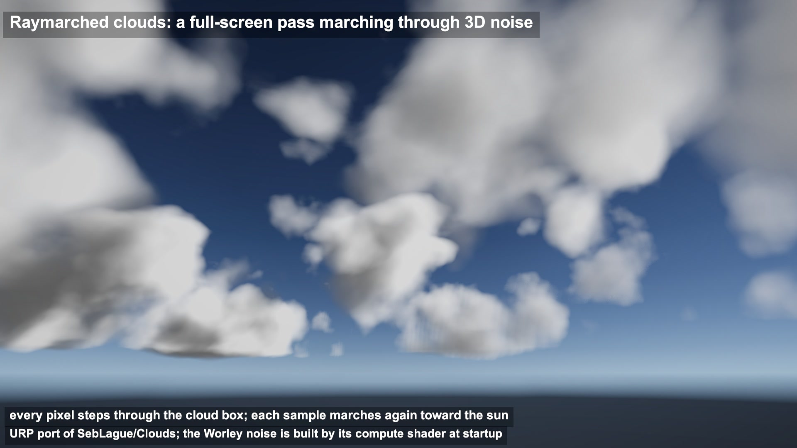

# Raymarched clouds in URP

Clouds with no meshes and no particles.

One full-screen pass marches each pixel's ray through 3D Worley noise, and marches again toward the sun.

Ported to Unity URP, with measured frame times.

## The problem

Clouds are volumes. Sprites and meshes look right from one side and fall apart when the camera moves around them. Marching rays through a density field gives real volume, but every pixel takes many texture samples.

## How it works

I read SebLague/Clouds (MIT) and ported it.

1. Noise: a compute shader fills a 132³ shape texture (4 channels) and a 64³ detail texture (3 channels). Each channel is three octaves of tiling, inverted Worley noise.

2. Density: shape noise x a height gradient (fades in over the bottom 20% of the box, out above 70%), minus an offset. Detail noise then eats into thin edges more than thick centres.

3. View march: from where the ray enters the cloud box, fixed 11 m steps, start point jittered with blue noise.

4. Light march: at each sample with density, 8 steps toward the sun. Beer's law gives how much sunlight arrives, with a floor so shadowed cloud never goes black.

5. Phase: two Henyey-Greenstein lobes (forward g 0.81, back g 0.33) blended 50/50, so cloud brightens toward the sun.

6. Output: background x transmittance + gathered light.

The repo also builds a weather map, but this commit never reads it in the density function. No powder term either.

## What I hit

The source is an OnRenderImage image effect, which URP never calls. The same shader now runs in URP's Full Screen Pass Renderer Feature, before post-processing, with the depth texture on.

The split screen needs different settings per half, so the material is updated in beginCameraRendering for each camera.

Surprise: turning off the light march saved nothing measurable (17.0 vs 17.0 ms). My reading: rays stop after a few dense samples, so the light march runs rarely, and the empty-space steps are the cost. 88 m steps took 4.2 ms.

## My build

The repo's cloud box (2 x 0.57 x 1.8 km) and its cloud and noise settings. Camera below the cloud layer; sun lowered to 30° (the original scene has it almost overhead).

Frame times: whole frame at 1920x1080 in the Editor on an M4 Mac mini, 20 renders timed after waiting for the GPU.

## Trade-offs

Cost scales with pixels x steps. Production cloud renderers usually march at lower resolution and reuse earlier frames; this port does neither.

Bigger steps are cheaper but skip thin cloud.

Steps are fixed in world units, so distant cloud gets as many samples as near cloud.

The noise is low resolution, so clouds close to the camera look soft.

## When to use it

Skies you fly through, changing weather, time-of-day lighting. For a static backdrop a skybox is far cheaper.

## Credits

Source: SebLague/Clouds by Sebastian Lague, https://github.com/SebLague/Clouds, commit fcc997c. License: MIT (Copyright (c) 2019 Sebastian Lague).

Code reused: yes, ported. Hidden/Clouds (ray-box test, blue-noise start offset, density from shape and detail noise with height gradient and edge fade, light march with Beer's law and darkness threshold, dual Henyey-Greenstein phase, compositing), NoiseGenCompute.compute (unchanged: tiling Worley noise and normalisation), the noise generation from NoiseGenerator.cs with the repo's Clouds Test noise settings, the CloudMaster values from the Clouds Test scene, and the repo's BlueNoise.png. The MIT notice is kept in the ported files.

Changed for URP: the shader runs in URP's Full Screen Pass Renderer Feature instead of OnRenderImage/Graphics.Blit; URP includes and depth texture; sun direction, colour and time passed from C#; the view-ray step size (a constant 11 in the source) and a density-only switch exposed for the comparison; weather map and noise viewer left out (the density function in this commit does not read the weather map).

My own code: scene setup (camera below the cloud layer, sun at 30 degrees, procedural sky), per-camera settings for the split screen, frame-time benchmark, labels.

Engine: Unity 6.3 LTS, Universal Render Pipeline 17.3, Metal.

No external models. Blue noise texture from the source repo (MIT).

## Files

- `BlueNoise.png`
- `CloudNoise.cs`
- `Clouds.shader`
- `CloudsDirector.cs`
- `Editor/BuildScene.cs`
- `NoiseGenCompute.compute`

## Build the scene

In the Unity editor: **Vidar Game Lab > Techniques**, then **Build** next to `raymarched-clouds`. From the command line: `tools/capture.sh raymarched-clouds GameTech.Posts.CloudsScene.Build`.
