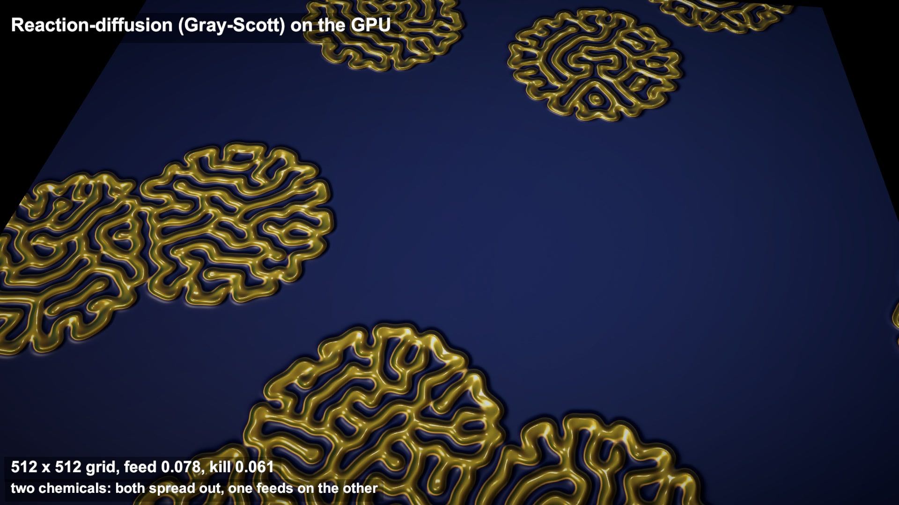

# Reaction-Diffusion

Two chemicals, two numbers. Change feed and kill, and the same equation grows spots, mazes or slow coral-like fronts. Gray-Scott reaction-diffusion on the GPU in Unity.

## The problem

Organic patterns like spots, stripes and coral are hard to paint by hand and hard to animate. Noise textures look random, not grown. Reaction-diffusion grows them from a simple local rule, and it can keep growing while you watch.

## How it works

This follows Keijiro Takahashi's open-source RDSystem for Unity.

1. Every cell holds two amounts, u and v. It starts with u = 1 everywhere and v = 1 in a few random seed cells.

2. Diffusion: each step, both spread to their 8 neighbours (weights 0.2 for the sides, 0.05 for the corners). u spreads 3 times faster than v.

3. Reaction: u + 2v turns into 3v, so v eats u where they meet.

4. Feed adds fresh u everywhere, kill removes v.

5. The display blends two materials at a v threshold and takes the surface normal from the v differences between neighbours.

With the reaction turned off, the seeds just blur away. With it on, they grow into patterns.

## What I hit

The source runs it as a Custom Render Texture. I moved its two passes, seeding and one update step, into a compute shader with two textures swapped every step.

Feed and kill values from common Gray-Scott maps assume a different speed ratio. The source spreads v at 1/3 the speed of u, so I tested 6 pairs and kept the 3 that look different.

At the source's 1024 x 1024 the pattern was so fine it looked like grain in the video. 512 x 512 shows the shapes.

I raised the seed density from the source's 0.1 to 0.4 (about 0.16 % of cells) so the patterns fill the grid within the video.

## My build

Unity 6.3 URP, one compute shader, half-float textures.

512 x 512: 0.06 ms per step on an Apple M4 Mac mini (Metal). At the source's 1024 x 1024 it is 0.17 ms.

24 steps per video frame.

Spots: feed 0.0367, kill 0.0649. Maze: feed 0.0547, kill 0.0632 (the source's values). Slow fronts: feed 0.078, kill 0.061.

The two materials and normals follow the source's surface shader. The colours and the two-light shading are mine.

## Trade-offs

It needs thousands of steps to settle, so plan the time or pre-run it.

Results depend on the grid size, the seed and the speed ratio, so values don't carry over between setups.

It is a flat 2D texture here; wrapping it on curved meshes needs more care at seams.

## When to use it

Animated organic textures, coral and skin patterns, growing decals, and procedural materials for stylised scenes.

## Credits

Technique source: keijiro/RDSystem, https://github.com/keijiro/RDSystem, commit 78994665f03b5b635634de58d2c50c8cbb19695c. License: Unlicense (public domain dedication, "This is free and unencumbered software released into the public domain").

Code reused: yes, ported from a Custom Render Texture shader to a Unity compute shader. From RDSystem.shader: the seeding pass (hashed random value per cell, v = 1 where it is below Pop x Pop x 0.01) and the update pass (3 x 3 Laplacian with 0.2 side and 0.05 corner weights, the Gray-Scott reaction u x v x v, feed and kill terms, saturate). From RDSystem.mat: Du = 1, Dv = 1/3, feed 0.0547, kill 0.0632. From the Surface shader graph: the idea of blending two materials with a smoothstep on v (threshold 0.13, edge smoothing 0.17) and normals from neighbour differences.

My own code: compute shader dispatch with two swapped textures, the diffusion-only switch, the other two feed/kill pairs, the 512 grid and seed density, the display shader's colours and two-light GGX shading, slabs, cameras, split screens and labels. The Gray-Scott model itself is from Gray and Scott (1980s chemistry papers); feed/kill pairs were picked by testing.

Engine: Unity 6.3 LTS, Universal Render Pipeline.

No external models, textures or images.

## Files

- `Editor/BuildScene.cs`
- `RDDirector.cs`
- `RDSim.cs`
- `Shaders/GrayScott.compute`
- `Shaders/RDSurface.shader`

## Build the scene

In the Unity editor: **Vidar Game Lab > Techniques**, then **Build** next to `reaction-diffusion`. From the command line: `tools/capture.sh reaction-diffusion GameTech.Posts.RDScene.Build`.
