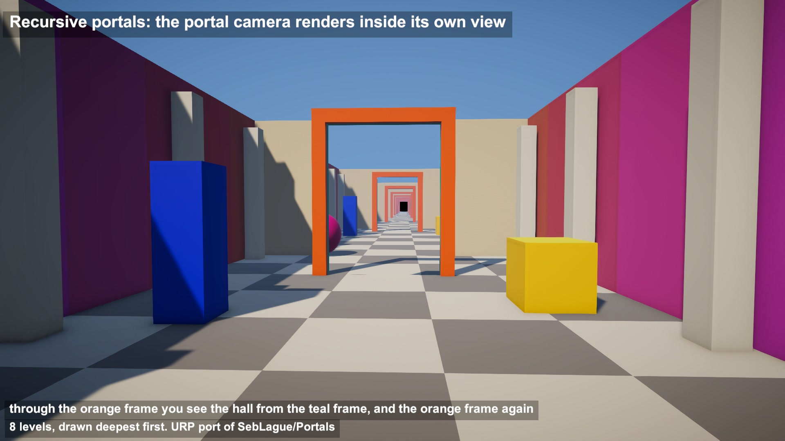

# Recursive portals in URP

A portal is a second camera.

Put two portals face to face and that camera has to render inside its own view, again and again.

Ported to Unity URP, 8 levels deep.

## The problem

A portal shows what a camera at the other portal sees. Easy, until the other side contains the first portal: the view through it then needs the view through it, and so on. And the portal camera must not draw whatever stands behind the exit portal.

## How it works

I read SebLague/Portals (MIT) and ported its camera code to URP.

1. Portal camera pose = exit portal's transform x inverse of the entry portal's transform x player camera. Apply it again and you get the next level.

2. It builds up to N poses, stopping early when the next portal no longer overlaps the previous one on screen.

3. It renders deepest first. The deepest level draws the inner portal as a flat colour; every shallower level sees the result of the one before.

4. Each render uses an oblique projection: the near plane is moved onto the portal surface, so nothing between the camera and the exit portal is drawn. Within 0.2 m of the portal it falls back to the normal projection.

5. The portal's own screen is hidden while its camera renders.

## What I hit

The source renders from OnPreCull, which URP never calls. I render the portal cameras in LateUpdate with Camera.Render().

The source writes every level into the one texture its screen samples. I alternate two textures per portal, so a level never reads the texture it is writing.

Split screen: each half needs different settings, so each player camera gets its own portal cameras, textures and screen copies on separate layers.

Not ported: travellers (teleporting and slicing objects that cross a portal) and the trick that lets the player walk through.

## My build

Open-roof hall, 10 x 26 m, coloured wall segments, a few props. Orange portal at the north end, teal portal at the south end, both facing north. Look into the orange one and you see the hall from the teal one, with the orange one in it again.

HDR portal textures at the camera's resolution; post-processing runs once on the final image.

Measured in the Editor on the M4: 8 levels took about 4.2 ms of CPU per frame just to submit the renders. 1 level took 0.6 ms (half-width view).

## Trade-offs

Every level is a full scene render: culling, shadows, draw calls. Cost grows with depth.

The overlap test saves a lot when portals are at an angle, but not when they face each other head on.

Oblique projection squeezes depth precision, which can upset depth-based effects such as SSAO.

## When to use it

Puzzle portals, magic doors, rooms that loop. With many portals, cap the depth and shrink the textures for deeper levels.

## Credits

Source: SebLague/Portals by Sebastian Lague, https://github.com/SebLague/Portals, commit 53ff52a. License: MIT (Copyright (c) 2020 Sebastian Lague).

Code reused: yes, ported. Portal.Render (pose chain, early stop, deepest-first rendering, flat colour at the deepest level), Portal.SetNearClipPlane (oblique near plane with the source's 0.05 m offset and 0.2 m limit), CameraUtility.VisibleFromCamera and BoundsOverlap, and the Portal shader (screen-space sampling, displayMask). The MIT notice is kept in the ported files.

Changed for URP: portal cameras render from LateUpdate with Camera.Render() (URP never calls OnPreCull); two textures per portal instead of one; one set of portal cameras and screens per player camera for the split screen; the screen shader rewritten in URP HLSL. Not ported: travellers and slicing, screen-thickness adjustment.

My own code: the hall builder, props, camera paths, split-screen comparison, render counter and timing, labels.

Engine: Unity 6.3 LTS, Universal Render Pipeline 17.3, Metal.

No external models, textures or images.

## Files

- `Editor/BuildScene.cs`
- `PortalDirector.cs`
- `PortalRig.cs`
- `PortalScreen.shader`

## Build the scene

In the Unity editor: **Vidar Game Lab > Techniques**, then **Build** next to `recursive-portals`. From the command line: `tools/capture.sh recursive-portals GameTech.Posts.PortalScene.Build`.
