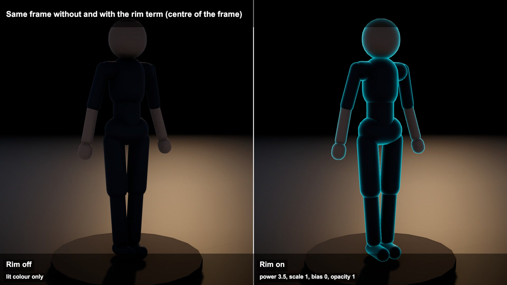

# Rim Light

A glowing outline from one line of math: the more a surface turns away from the camera, the more rim colour it gets. Then make it breathe with a sine and break it up with 3D noise.

## The problem

A character in a dark scene loses its shape against the background. A real back light helps only on the side it hits, and needs shadows and tuning per shot. A rim term in the material outlines the whole silhouette from any camera angle.

## How it works

This follows AdultLink's Rimlight shader, rewritten for URP.

1. Take N dot V: 1 where the surface faces the camera, 0 at the silhouette.

2. Rim = bias + scale x (1 - N dot V) to the power.

3. Multiply by colour and opacity and add it to the lit colour as emission.

4. Pulsate: scale becomes scale / 2 x (sin(frequency x time) + 1), so the rim swings between 0 and full.

5. Noise: 3D simplex noise at world position x noise scale, scrolled by a speed vector, plus 1. The rim is multiplied by 0 to 2, so the edge breaks into patches.

## What I hit

Frequency is in radians per second. The default 2 is one breath every 3.1 s. I used 4: the formula says 1.57 s, the video shows 48 frames between peaks at 30 fps, 1.6 s.

At noise scale 6 the variation was barely visible on a thin rim. I used scale 10 and power 2 for that comparison.

The noise lives in world space, not on the body, so a moving character slides through it.

The source draws both faces. Back faces have N dot V below 0, so the rim goes past full. I cull back faces on this closed mesh.

## My build

Unity 6.3, URP, Apple M4 Mac mini, Metal. Hand-written HLSL with the source's rim formula and its noise function copied unchanged. Base shading is URP's PBR (metallic 0, smoothness 0.3), not the source's specular setup with texture maps.

Stand-in mannequin on a pedestal, warm light from behind and to the side, camera orbiting at 8 degrees per second.

Rim colour (0, 0.83, 1) x 1.5, power 3.5, scale 1, bias 0, opacity 1.

Comparisons: off / on; power 1.5 / 3.5 / 6; pulsate at frequency 4; noise at scale 10, speed (0, 2.5, 0).

No frame times measured.

## Trade-offs

It knows nothing about lights: the rim shows on every silhouette, lit side or not.

Flat faces pointing at the camera get no rim at all; it needs curved normals.

It only adds light, so on bright materials the outline washes out.

## When to use it

Picking out characters in dark scenes, hover and selection highlights, energy shields, spirits. Pulse for "this is active", noise for anything that should feel unstable.

## Credits

Technique source: Rimlight by Guillermo Angel (AdultLink), https://github.com/AdultLink/Rimlight, commit 9ddf81c6fe09c5de7ea39fa8c68b87f372bce55c, MIT License, Copyright (c) 2018 Guillermo Angel. Used: the rim light shader's rim term, pulsate and noise logic (rewritten for URP in HLSL with the same formula and parameters) and its 3D simplex noise function (copied unchanged). Nothing else from the repository is used.

Engine: Unity 6.3 LTS (6000.3.28f1) with the Universal Render Pipeline 17.3. Used for rendering and its PBR lighting as the base shading. It is not the source of the technique.

My own code: the URP shader passes around the rim term, the scene built from code (pedestal, floor, light, fog), the stand-in mannequin's idle pose, the camera orbit, the band compositor, the timeline, labels and video.

No external models or assets.

## Files

- `Editor/BuildScene.cs`
- `RimCompose.shader`
- `RimDirector.cs`
- `Rimlight.shader`

## Build the scene

In the Unity editor: **Vidar Game Lab > Techniques**, then **Build** next to `rim-light`. From the command line: `tools/capture.sh rim-light GameTech.Posts.RimScene.Build`.
