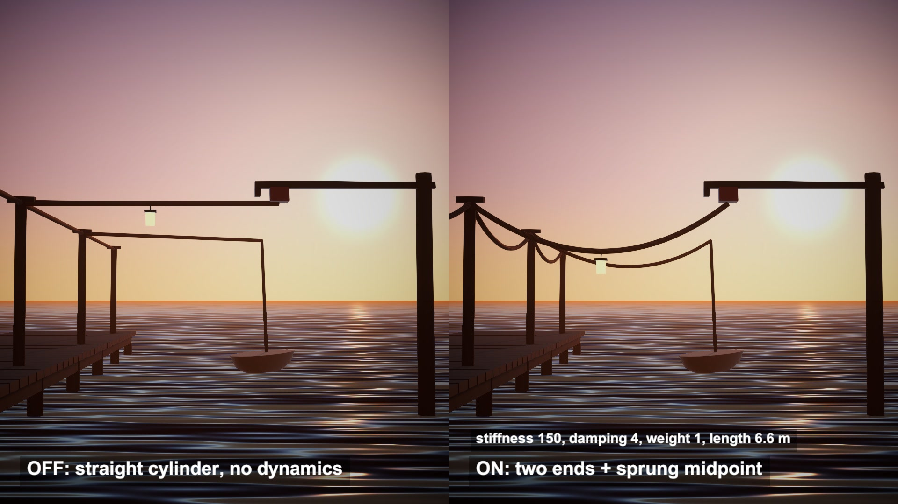

# Ropes and cables from one sprung midpoint

A rope faked with one spring, after Ali Rasheed's Optimized Ropes And Cables for Unity. Two fixed ends and one sprung midpoint shape a curve. Nothing is simulated along the rope.

## The problem

A simulated rope is a chain of points with constraints between them, solved several times per frame. That is fair for the one rope a player climbs. A harbour or a street full of cables needs dozens that only have to sag and sway.

## How it works

Take the two ends. Pick a point between them and lower it by the slack, which is the rope length minus the distance between the ends. That is the target.

A second point chases the target with a spring and a damper. Stiffness pulls it in and damping removes speed. Wind adds a push on top.

The rope is a rational quadratic Bezier curve from one end to the other, with the chasing point as its control point. The midpoint weight says how hard the curve is pulled towards it. At 1 the sag is a soft arc. At 6 it becomes a V, as if something heavy hangs there.

The curve is then sampled into a Line Renderer, or into a tube mesh.

## What I hit

The scripts were written for Unity 2022. They ran in Unity 6.3 without a single edit.

Rope length is only a slack setting. My main rope has length 6.6 m over a 5 m span. The control point sits 1.6 m low and the curve sags 0.8 m, which works out to a drawn length near 5.3 m.

The mesh takes its width as a radius. A mesh width of 0.05 matches a line width of 0.1.

The spring runs in the fixed step. I set it to 1/60 s so every video frame gets exactly two steps.

Wind strength is a product of two noise values, so it never turns negative. The rope leans downwind and comes back.

## My build

Unity 6.3 with URP. Seven ropes on a pier at dusk, each a tube of 24 by 8 divisions with 245 vertices, rebuilt every frame.

With stiffness 150 and damping 4, I let one end jump back 1.7 m. The midpoint ended up 0.77 m off its target and was within 2 cm after 1.93 s. At stiffness 600 and damping 20 a 1 m tug settled in 0.10 s. At stiffness 60 and damping 2 it was still swinging after 2 s.

Wind force 120 pushed the middle up to 0.85 m sideways, 0.48 m on average.

## Trade-offs

One curve per rope, so it cannot form an S or wrap around anything. Nothing collides, not even with the ground, and the rope cannot be cut. The author lists ground detection and cutting as future work. The length stretches whenever the ends move apart.

## When to use it

Background cables and mooring lines that nobody touches. Keep a real rope solver for the one the player holds.

## Credits

Technique and code: Optimized Ropes And Cables by Ali Rasheed (Ali10555), https://github.com/Ali10555/OptimizedRopesAndCables, commit c063a922e6167dc0f8467ffa94b052f9cbcdf9ec, MIT License, Copyright (c) 2024 Ali Rasheed. Its three scripts (Rope, RopeMesh, RopeWindEffect) are used unchanged. The repo's sample scenes, models and textures are not used.

Engine: Unity 6.3 LTS (6000.3.28f1) with the Universal Render Pipeline 17.3. Used for rendering. It is not the source of the technique.

My own code: the pier, boat, sea and sky built from code, the rope texture generated from code, the timeline that moves the rope ends and switches the parameters, the debug markers, labels and video. No external models or assets.

## Files

- `DuskSky.shader`
- `Editor/BuildScene.cs`
- `RopeDirector.cs`
- `Source/LICENSE`
- `Source/Rope.cs`
- `Source/RopeMesh.cs`
- `Source/RopeWindEffect.cs`

## Build the scene

In the Unity editor: **Vidar Game Lab > Techniques**, then **Build** next to `ropes-and-cables`. From the command line: `tools/capture.sh ropes-and-cables GameTech.Posts.RopeScene.Build`.
