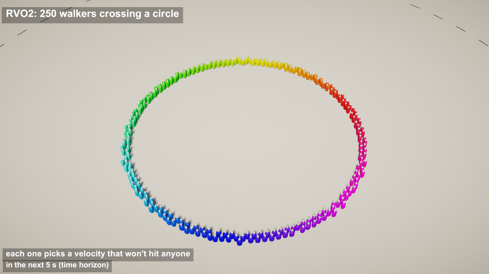

# RVO crowd avoidance

250 walkers cross a circle, all heading for the opposite side. Walking straight and pushing apart: 37 overlapping pairs on average. RVO2: under 2. Same start, same goals, same speed.

## The problem

Crowds that only steer at the last moment walk into each other, then get shoved apart. It looks like bumper cars and it jams. Real people look a few seconds ahead and pick a gap before they reach it.

## How it works

This uses the RVO2 library from UNC Chapel Hill (C# version), which implements ORCA, optimal reciprocal collision avoidance.

1. Each walker wants a velocity: straight at its goal at walking speed.

2. For every nearby walker, the set of velocities that would hit it within the time horizon is a cone. ORCA cuts it with a half-plane and each of the two walkers takes half of the job.

3. A small linear program picks the allowed velocity closest to the one the walker wanted.

4. If no velocity is allowed (a very dense spot), a fallback picks the least bad one, so some overlap can still happen.

## What I hit

The C# library uses .NET 8 argument checks that Unity's runtime doesn't have. I added a small shim with the same checks instead of changing the maths.

My first circle was 35 m across for 250 walkers. They started shoulder to shoulder, so both methods jammed at once and the comparison showed nothing. The library's own circle example spaces agents about 3 radii apart, so I moved to a 60 m radius ring.

I count overlaps as pairs closer than 2 radii minus 5 cm. Counting pairs that just touch would punish RVO2, which packs walkers right against each other.

## My build

Unity 6.3 URP. 250 walkers, radius 0.4 m, 1.4 m/s, 10 steps per second, each looks at its 10 nearest within 10 m.

Split 1: seek + push apart (my baseline: walk at the goal, then separate overlapping pairs twice per step) vs RVO2 with a 5 s horizon.

Split 2: RVO2 with a 0.5 s vs 5 s horizon.

All three runs are simulated first, then played back at 10x from 20 s in. The labels show the live overlap count and the peak so far.

RVO2 step for 250 walkers: 0.69 ms on an Apple M4 Mac mini (CPU, all cores).

## Trade-offs

Measured in these runs: seek + push apart gets everyone across in 104 s with 37 overlapping pairs on average (444 at worst). RVO2 with a 0.5 s horizon: 148 s, 2.4 on average. With 5 s: 217 s, 1.8 on average.

A longer horizon is more careful, which means slower. In the dense middle, both RVO2 runs still overlap for a while (up to 137 and 168 pairs): ORCA has no answer when every direction is blocked.

It avoids other agents only. Walls need its obstacle polygons, and routes need a path planner on top.

## When to use it

Pedestrians, units in strategy games, drones and robots: anything with a goal and neighbours, from tens to thousands of agents. For huge dense crowds, flow fields or continuum methods scale better.

## Credits

Technique source: snape/RVO2-CS (RVO2 Library, C# version), https://github.com/snape/RVO2-CS, commit de124a275d51d421bb9e2a77952210527ab60b04. License: Apache-2.0. Copyright: SPDX-FileCopyrightText 2008 University of North Carolina at Chapel Hill. Authors of the method: Jur van den Berg, Stephen J. Guy, Jamie Snape, Ming C. Lin, Dinesh Manocha (ORCA, "Reciprocal n-body collision avoidance").

Code reused: yes, the library itself is included (Agent.cs, KdTree.cs, Line.cs, Obstacle.cs, RVOMath.cs, Simulator.cs, Vector2.cs) with its Apache-2.0 license text. Modification: in Simulator.cs, the .NET 8 calls ArgumentOutOfRangeException.ThrowIf... were replaced with an equivalent Guard class (new file Guard.cs, marked as a change) because Unity's runtime lacks those APIs. The avoidance maths is unchanged. The circle-crossing setup follows the library's Circle example.

My own code: the Unity scene, the seek + push-apart baseline, recording and playback of the three runs, the overlap and arrival counters, stand-in walkers (capsule + sphere), cameras, split screens and labels.

Engine: Unity 6.3 LTS, Universal Render Pipeline.

No external models, textures or images.

## Files

- `CrowdDirector.cs`
- `Editor/BuildScene.cs`
- `RVO/Agent.cs`
- `RVO/Guard.cs`
- `RVO/KdTree.cs`
- `RVO/LICENSE.txt`
- `RVO/Line.cs`
- `RVO/Obstacle.cs`
- `RVO/RVOMath.cs`
- `RVO/Simulator.cs`
- `RVO/Vector2.cs`

## Build the scene

In the Unity editor: **Vidar Game Lab > Techniques**, then **Build** next to `rvo-crowd-avoidance`. From the command line: `tools/capture.sh rvo-crowd-avoidance GameTech.Posts.CrowdScene.Build`.
