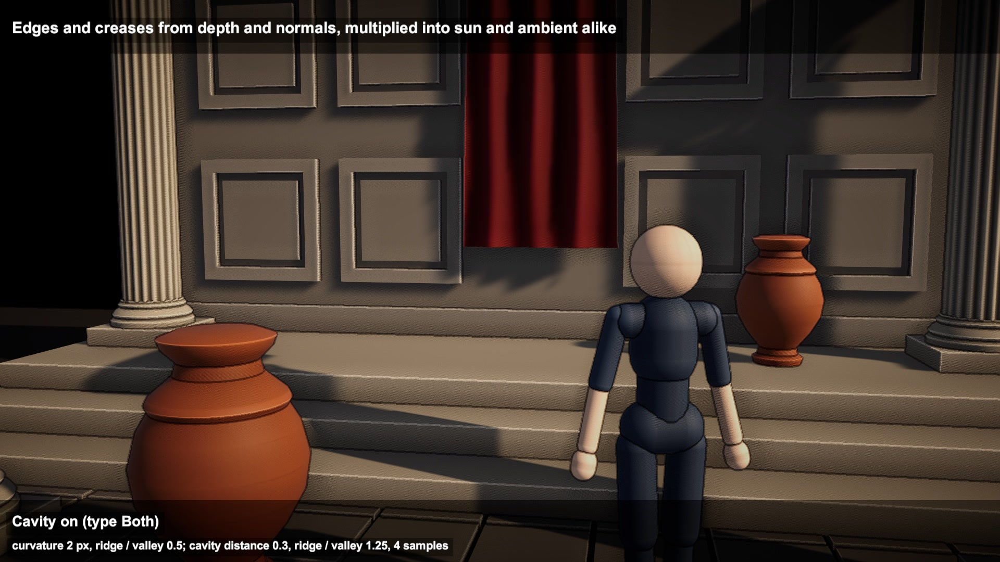

# Screen-space cavity

Flat-coloured stone looks like cardboard. One screen pass that reads depth and normals darkens every crease and brightens every edge, with no extra geometry or textures.

## The problem

Panels, steps, mouldings and cloth folds carry their shape in small creases and edges. With flat colours and one sun, half of that detail disappears in shadow and the other half washes out in light. Baked curvature maps fix it only for assets made that way.

## How it works

This follows malyawka's URP Screen Space Cavity, ported to Unity 6.

1. Curvature: read the view-space normal one step up, down, left and right. Up minus down plus right minus left is positive on a convex edge, negative in a fold. A soft clamp keeps it in range.

2. Cavity: rebuild the view position from depth, throw 4 random points within a small radius, and project them back. A sample above the surface counts toward a crease, one below it toward an edge, weighted down with distance.

3. Both go into one 8-bit buffer as a light multiplier: (1 - cavity) x (1 + edges) x (1 + curvature).

4. The lit shader multiplies sun and ambient light by that value. Shadowed areas get the outlines too.

## What I hit

The source is a URP 10 renderer feature. URP 17 removed the render target API it uses and now stores world-space normals, while the math expects view-space ones. I draw my own buffer with view-space normals and linear depth, then run the source's curvature and cavity functions unchanged.

The code divides the cavity sum by the sample count twice, so raising the sample count also weakens the effect. I kept 4 samples.

At 1080p the default 1 px curvature step draws lines too thin to read in a video, so I used 2 px.

It is not ambient occlusion: the reach is short (15 cm here), it also brightens convex edges, and it scales direct sunlight too.

## My build

Unity 6.3, URP, Apple M4 Mac mini, Metal. A stone hall built from code with a tiled floor, steps, fluted pillars, framed wall panels, a hanging cloth, two urns and a stand-in mannequin, all flat colours.

Settings: curvature step 2 px, ridge and valley 0.5; cavity distance 0.3 (sample radius 0.15 m), ridge and valley 1.25, 4 samples.

Measured on the buffer in the video, share of pixels changed by more than 10%: curvature only 12% darker and 11% brighter, cavity only 26% and 22%, both 31% and 26%.

Cavity distance 0.1 / 0.3 / 0.8: 9% / 26% / 40% of pixels darkened by more than 10%.

No frame times measured.

## Trade-offs

4 random samples per pixel leave visible grain on the cavity term. There is no blur pass.

Screen space only: edges hidden behind other objects or outside the frame contribute nothing.

A large distance spreads dark halos onto nearby flat surfaces.

## When to use it

Stylised and flat-shaded scenes, kitbashed environments, architecture previews, sculpt-style views. Anywhere modelled detail should read without baking curvature maps.

## Credits

Technique source: URP Screen Space Cavity by MalyaWka (Pavel Pustovalov), https://github.com/malyawka/URP-ScreenSpaceCavity, commit ff60ac2fc13e550a9c133f5c41c2c9e902ab9563, BSD 3-Clause License, Copyright (c) 2021, MalyaWla (Pavel Pustovalov). Used: the curvature and cavity functions from its SSC shader include (copied, with only the depth and normal reads replaced), the full-screen pass layout and keywords of its Cavity shader, the settings and parameter packing of its ScreenSpaceCavity renderer feature, and the way its ToonyLit shader multiplies light by the cavity buffer x 4. Redistributed in source form under the BSD 3-Clause terms with the copyright notice, the licence conditions and the disclaimer kept in the published code.

Engine: Unity 6.3 LTS (6000.3.28f1) with the Universal Render Pipeline 17.3. Used for rendering, shadows and its PBR lighting as the base shading. It is not the source of the technique.

My own code: the view-space normal and depth buffer pass, the command-buffer driver that replaces the URP 10 renderer feature, the lit surface shader around the multiply, the stone hall built from code, the stand-in mannequin's idle pose, the camera move, the band compositor and buffer view, the timeline, labels and video.

No external models or assets.

## Files

- `CavityCompose.shader`
- `CavityDirector.cs`
- `CavityLit.shader`
- `CavityPass.cs`
- `Editor/BuildScene.cs`
- `LICENSE-URP-ScreenSpaceCavity.txt` (BSD 3-Clause licence of the source repository)
- `SSC.hlsl`
- `ScreenSpaceCavity.shader`

## Build the scene

In the Unity editor: **Vidar Game Lab > Techniques**, then **Build** next to `screen-space-cavity`. From the command line: `tools/capture.sh screen-space-cavity GameTech.Posts.CavityScene.Build`.
