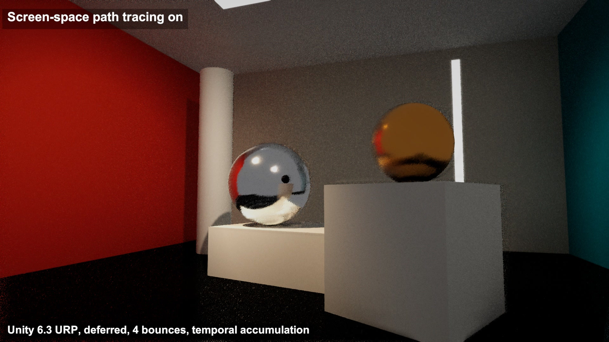

# Screen-space path tracing in URP

Path traced bounce light in Unity URP, using only what is already on screen. The red wall tints the floor and the chrome ball, and a still camera converges to 128 samples.

## The problem

URP lights each pixel from its lights plus flat ambient or a probe. Light that bounces off a red wall onto the floor, or a reflection of the room in a chrome ball, needs paths traced through the scene. Hardware ray tracing is not available on many targets, this Mac included.

## How it works

This uses jiaozi158's UnitySSPathTracingURP, a URP renderer feature.

1. URP renders the frame in deferred mode. The feature copies the lit colour, then reads depth and the G-buffer (albedo, normal, smoothness, metallic).

2. From every pixel it starts one path. Each bounce picks a diffuse or a glossy direction and ray marches through the depth buffer, with back-face depth for thickness, until it hits something on screen.

3. A hit point gives off the colour URP already lit there. Up to 4 bounces, with Russian roulette ending weak paths early.

4. A path that leaves the screen has nothing to hit. It can read a reflection probe instead, or return black.

5. One path per pixel is noise. Real-time mode reprojects last frame's result with motion vectors and blends it in. Offline mode adds one sample per frame while the camera holds still, and restarts when it moves.

## What I hit

The feature keeps one sample counter and one history per instance, so two split-screen cameras on one renderer would reset each other. Each camera gets its own renderer with its own copy.

With 32-bit HDR the source caps offline accumulation at 64 samples. I switched the colour buffer to 64-bit to reach 128.

The path tracer zeroes scene ambient while it runs, so paths that miss need the probe. In deferred mode a script hands the probe to the material.

My capture skips warm-up frames, so the first frame had no history and was all grain. The opening camera now renders during warm-up.

## My build

Unity 6.3, URP, deferred, Apple M4 Mac mini, Metal. The source's renderer feature, volume and shader, unchanged.

A room built from code: red and teal walls, glossy black floor, chrome and gold balls, white blocks, two emissive strips, three spot lights, no ambient. One probe, 256 px, rendered once at start without path tracing.

Settings: 4 bounces, 1 path per pixel per frame, offline cap 128.

Offline accumulation reached 128 samples 4.3 s (128 frames at 30 fps) after the camera stopped.

Mean brightness of the half frames (video luma, 16 to 235): off 30, on 68. Probe fallback off 42, on 77.

No frame times measured.

## Trade-offs

Only what is on screen can bounce light: surfaces out of view add nothing.

Most paths that miss read the probe, so the probe carries a large part of the result.

Real-time mode keeps visible grain on dark, glossy surfaces.

Deferred rendering and no MSAA.

## When to use it

Interiors and showcase scenes without hardware ray tracing, where some grain is fine. Offline mode also gives clean stills.

## Credits

Technique source: UnitySSPathTracingURP by jiaozi158, https://github.com/jiaozi158/UnitySSPathTracingURP, commit 6bee8fce5ee313d92597cb59d98abb876424df29. License: MIT, Copyright (c) 2022 jiaozi158. Used unchanged: the renderer feature (ScreenSpacePathTracingAccumulation), the path tracing volume component, the path tracing shader and its include files, the material and its noise textures. The repo's sample scenes, its Refraction Lit shader graph and the reflection probe setter script are not used.

Engine: Unity 6.3 LTS (6000.3.28f1) with the Universal Render Pipeline 17.3, deferred rendering. It is the renderer, not the source of the technique.

My own code: the room and props built from code, the pipeline copy with one renderer per camera, the script that sets the probe on the path tracing material, the split-screen timeline, labels and video.

No external models or assets.

## Files

- `Editor/BuildScene.cs`
- `SSPT/LICENSE.txt`
- `SSPT/Noise.meta`
- `SSPT/Noise/OwenScrambledNoise256.png`
- `SSPT/Noise/OwenScrambledNoise256.png.meta`
- `SSPT/Noise/RankingTile256SPP.png`
- `SSPT/Noise/RankingTile256SPP.png.meta`
- `SSPT/Noise/ScramblingTile256SPP.png`
- `SSPT/Noise/ScramblingTile256SPP.png.meta`
- `SSPT/PathTracing.hlsl`
- `SSPT/PathTracing.hlsl.meta`
- `SSPT/PathTracingConfig.hlsl`
- `SSPT/PathTracingConfig.hlsl.meta`
- `SSPT/PathTracingDenoise.hlsl`
- `SSPT/PathTracingDenoise.hlsl.meta`
- `SSPT/PathTracingFallback.hlsl`
- `SSPT/PathTracingFallback.hlsl.meta`
- `SSPT/PathTracingInput.hlsl`
- `SSPT/PathTracingInput.hlsl.meta`
- `SSPT/PathTracingSetReflectionProbe.cs`
- `SSPT/PathTracingSetReflectionProbe.cs.meta`
- `SSPT/PathTracingUtilities.hlsl`
- `SSPT/PathTracingUtilities.hlsl.meta`
- `SSPT/PathTracingVolume.cs`
- `SSPT/PathTracingVolume.cs.meta`
- `SSPT/ScreenSpacePathTracing.mat`
- `SSPT/ScreenSpacePathTracing.mat.meta`
- `SSPT/ScreenSpacePathTracing.shader`
- `SSPT/ScreenSpacePathTracing.shader.meta`
- `SSPT/ScreenSpacePathTracingAccumulation.cs`
- `SSPT/ScreenSpacePathTracingAccumulation.cs.meta`
- `SSPTDirector.cs`

## Build the scene

In the Unity editor: **Vidar Game Lab > Techniques**, then **Build** next to `screen-space-path-tracing`. From the command line: `tools/capture.sh screen-space-path-tracing GameTech.Posts.SSPTScene.Build`.
