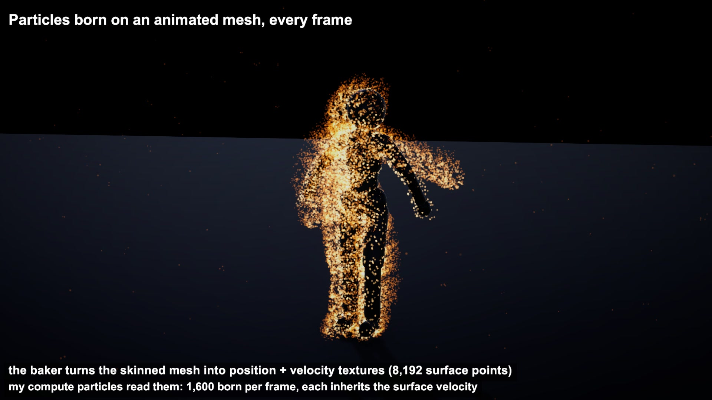

# Particles from a skinned mesh

Particles that pour off a dancing body. The trick is to read the skinned mesh every frame, not the mesh you imported.

1,600 particles born per frame from 8,192 surface points.

## The problem

You want sparks, dust or magic to stream off a moving character. The particle system needs spawn points on the body as it is now, plus how fast that bit of skin is moving. The imported mesh only knows the rest pose.

## How it works

This uses the skinned mesh baker from Keijiro Takahashi's open-source Smrvfx (Unity).

1. At start, the baker scatters 8,192 sample points over the mesh surface, weighted by triangle area.

2. Every frame it bakes the skinned mesh (SkinnedMeshRenderer.BakeMesh) and writes each sample's position, normal and velocity into float textures. Velocity is this frame's position minus last frame's, times the frame rate.

3. My compute shader picks random texels, spawns particles there, adds the surface velocity times an "inherit" factor and a small push along the normal.

4. Each particle then drifts on a swirl field with drag and a little lift, glowing white-hot to red as it ages.

## What I hit

Smrvfx is built for VFX Graph, which is not in this project. I used the older baker that writes plain textures and fed my own compute particles instead; the binder for VFX Graph is left out.

The baker runs in LateUpdate, so I pose the character in Update and run my particle step after the baker, so both read the same frame.

First render was a white blob: 2,400 bright additive particles per frame. I dropped to 1,600 and lowered the brightness.

## My build

Unity 6.3 URP on an M4 Mac mini. A procedural dance on a stand-in mannequin (4,788 vertices). Three systems of 131,072 particle slots each.

Split 1: spawn on the bind pose (a hidden copy that only follows the root) vs the skinned mesh baked this frame.

Split 2: inherit 0 vs inherit 1 on the same skinned spawn points.

BakeMesh of the mannequin costs 0.02 ms on the CPU per frame.

## Trade-offs

BakeMesh is CPU skinning plus an upload. Cheap for 5k vertices, not for a crowd of 100k-vertex heroes.

Velocity from two frames is a straight line, so fast spins smear a little.

Random texels pick points with repeats; fine for sparks, not for even coverage.

## When to use it

Characters that burn, dissolve, shed dust or leave light trails. If the mesh does not deform, sample it once and move the points with the transform instead.

## Credits

Technique source: keijiro/Smrvfx, https://github.com/keijiro/Smrvfx, commit 898ced94e22c28fca591a1a268fdb034dec43292 (2020-12-08, the version whose baker writes plain textures). License: Unlicense (public domain), by Keijiro Takahashi.

Code reused: the baker is included unchanged from Packages/jp.keijiro.smrvfx: Runtime/SkinnedMeshBaker.cs, SkinnedMeshBakerProperties.cs, Internal/CombinedMesh.cs, SamplePoint.cs, SamplePointGenerator.cs, Utility.cs and Resources/SkinnedMeshBaker.compute, plus its LICENSE. Left out: SkinnedMeshBinder.cs (VFX Graph property binder) and the package asmdef.

My own code: the compute particle system that reads the baked position, velocity and normal maps (emit with an inherit factor, drag, lift, swirl), the additive particle shader, the procedural dance, the hidden bind-pose copy, scene, cameras, labels and timing.

Character: the code-built stand-in mannequin (capsules on a 17-bone rig). No external models.

Engine: Unity 6.3 LTS, Universal Render Pipeline, compute shaders on Metal. VFX Graph was not used.

## Files

- `Editor/BuildScene.cs`
- `MeshParticlesDirector.cs`
- `Shaders/MeshParticleDraw.shader`
- `Shaders/MeshParticles.compute`
- `Smrvfx/Internal/CombinedMesh.cs`
- `Smrvfx/Internal/SamplePoint.cs`
- `Smrvfx/Internal/SamplePointGenerator.cs`
- `Smrvfx/Internal/Utility.cs`
- `Smrvfx/LICENSE`
- `Smrvfx/Resources/SkinnedMeshBaker.compute`
- `Smrvfx/SkinnedMeshBaker.cs`
- `Smrvfx/SkinnedMeshBakerProperties.cs`

## Build the scene

In the Unity editor: **Vidar Game Lab > Techniques**, then **Build** next to `skinned-mesh-particles`. From the command line: `tools/capture.sh skinned-mesh-particles GameTech.Posts.MeshParticlesScene.Build`.
