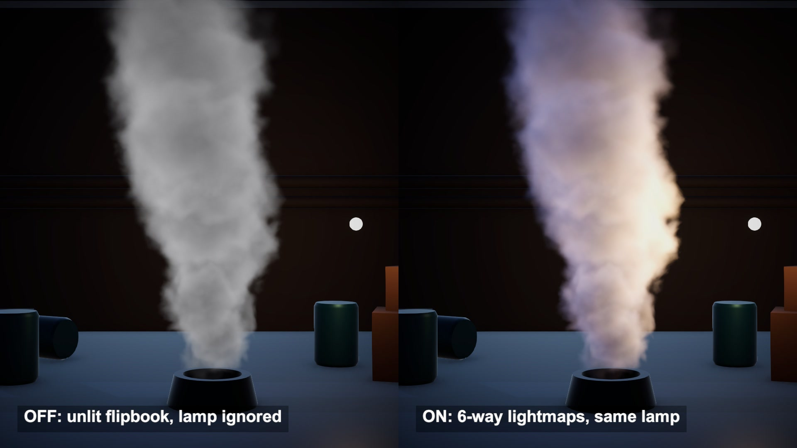

# Six-way lighting for smoke sprites

Smoke sprites that react to a moving lamp, after Thomas Iché's URP smoke lighting samples. Each puff carries six baked lightmaps, and the light direction picks the mix.

## The problem

A smoke flipbook is a stack of flat cards with a picture of smoke on each. The shading is already in the picture, so a lamp that moves around the column changes nothing. A normal map helps a little, but it treats smoke like a hard surface. The side away from the light goes dark, and light from behind never comes through.

## How it works

Render the puff six times, each time lit from one side: right, left, top, bottom, back, front. Pack the six greyscale results into two textures.

At run time the light direction is turned into the card's own space. Each axis gives a weight. The positive part of X scales the right map and the negative part scales the left map. Y and Z work the same way. The weighted maps are added up, then multiplied by the light colour and its attenuation. Every light goes through the same sum, on top of ambient.

The back map was baked with light passing through the puff. That is why thin edges glow when the lamp is behind the column.

## What I hit

The bake's up has to match the card's up, or the top map lights the bottom. I read the atlas back to check: the top map is brighter in its upper half, 0.143 against 0.075.

My first puffs were noisy balls with hard rims, and the column looked like stacked discs. I warped the noise and lowered the density gain. Each card also got its own roll and starting frame.

Each card rolls, so its tangent frame has to roll with it. Otherwise the lit side spins with the texture.

With a strong warm lamp the lit smoke read as fire. I dropped the lamp intensity to 5 and the smoke albedo to 0.6.

## My build

Unity 6.3 with URP on an Apple M4 Mac mini, Metal. The source is built with VFX Graph and Shader Graph. I rewrote its lighting subgraphs by hand in HLSL and drive the cards with a small particle system of my own: 12 cards per second, 74 alive at the 12 second mark.

The lightmaps are my own bake. A shader ray-marches a noise puff with 44 steps, plus 8 steps toward each light, into three atlases of 2048 pixels with 16 frames each. The first atlas took 489 ms to bake and read back in one run.

One point light circles 2 m from the column, and a dim directional light adds a cool fill. The video puts six-way next to two cheaper workflows: an unlit flipbook, and a normal map with a ramp at directionality 0.9.

## Trade-offs

Two textures per flipbook instead of one. Six directions is coarse, so a light between two axes is a blend of two maps. Each map holds only its own puff's shadowing, so one card never shadows another. In my build the lights cast no shadows onto the smoke either. The density look is fixed at bake time.

## When to use it

Thick smoke or dust made of sprites, in scenes where lights move or flash close to it.

## Credits

Technique source: Unity-URP-SmokeLighting by Thomas Iché (peeweek), https://github.com/peeweek/Unity-URP-SmokeLighting, commit 0417387bdb83496f2a02b34688c464b50fd82116, MIT License, Copyright (c) 2022 Thomas Iché. Its lighting subgraphs (six-way lighting, normal lighting with an attenuation ramp, the sum over all lights) are rewritten by hand as an HLSL shader. The repo's flipbooks, lightmaps, ramp textures, VFX graphs and scenes are not used.

Engine: Unity 6.3 LTS (6000.3.28f1) with the Universal Render Pipeline 17.3. Used for rendering. It is not the source of the technique.

My own code: the six lightmaps and the normal map (baked at start by a ray-march shader from a procedural noise puff), the ramp, the particle system and billboards, the hall built from code, the debug panel, the timeline, labels and video. No external models or assets.

## Files

- `Editor/BuildScene.cs`
- `SmokeBake.shader`
- `SmokeDirector.cs`
- `SmokeLit.shader`
- `SmokePanel.shader`

## Build the scene

In the Unity editor: **Vidar Game Lab > Techniques**, then **Build** next to `smoke-lighting`. From the command line: `tools/capture.sh smoke-lighting GameTech.Posts.SmokeScene.Build`.
