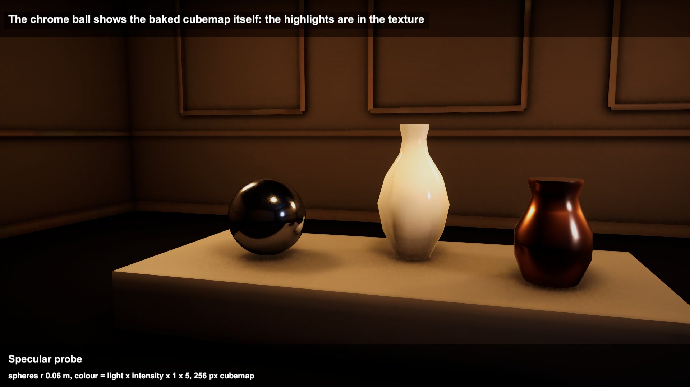

# Specular probes

Baked lights are cheap at runtime, but they never show up in reflections, so glossy props look dull. The fix: put a tiny, very bright sphere at each light while the reflection probe bakes.

## The problem

A lightmap stores diffuse light only. A reflection probe bakes what a camera sees from its centre, and a baked light has no geometry, so the cubemap has no hot spot where the lamp is. Chrome and copper reflect the room but never the bulbs. Realtime lights fix that, at a per-pixel cost.

## How it works

This follows zulubo's SpecularProbes: two small scripts.

1. Each baked light gets a component with a sphere radius and a brightness multiplier.

2. Just before the probe bakes, an unlit sphere is spawned at every such light in range. Its colour is light colour x intensity x multiplier x 5.

3. The probe renders the room with those spheres in it, so each lamp becomes a small cluster of very bright texels in the cubemap.

4. The spheres are deleted. Nothing extra exists at runtime: the normal probe reflection, blurred by roughness through the cubemap mips, turns those texels into highlights.

## What I hit

The sphere colour is set as an ordinary colour, so in a linear-colour project it goes through the sRGB-to-linear curve. Colour 50 lands in the cubemap as about 5,464. Brightness grows much faster than the multiplier suggests: 0.04 gave a peak of 4.6.

Enabling a probe or swapping its cubemap between two renders in the same frame only showed up a frame later in URP. For the side-by-side bands, each band renders its own copy of the room, 100 m apart, with its own probe. All copies read the same lightmap texels.

## My build

Unity 6.3, URP, Apple M4 Mac mini, Metal. The source's two scripts, with Unity's built-in sphere in place of the repo's mesh and a helper that bakes the probe to a chosen file.

A room built from code: a plinth with a chrome ball, a ceramic vase and a copper jug, a black glossy sphere on the floor. Three warm pendants and one cool wall light, all baked; no realtime lights. One box-projected probe, 256 px HDR cubemap.

Tuned: sphere radius 0.06 m, multiplier 1.

Measured in the baked cubemaps:

Plain probe: brightest texel 2.1, no texels above 4.

Specular probe: brightest 5,464, 325 texels above 4 (of 393,216).

Radius 0.35 m: 11,869 texels above 4, a broad glow instead of a highlight.

No frame times measured.

## Trade-offs

The highlights are frozen into the probe. Move a light or switch it off and its highlight stays until the next bake.

Box projection puts them in the right place only inside the probe's box; far from the probe centre they drift.

Every light becomes a round dot. Long tube or panel lights need other shapes.

Tuning is by eye, and the sRGB curve makes the multiplier very sensitive.

## When to use it

Fully baked scenes: interiors, VR and mobile, anywhere realtime lights are too expensive.

## Credits

Technique source: SpecularProbes by zulubo (Zach Tsiakalis-Brown), https://github.com/zulubo/SpecularProbes, commit aa436000c6554e18558606c434bbf5e2f0d49a7a, MIT License, Copyright (c) 2020 Zach Tsiakalis-Brown. Used: its two scripts, SpecularProbeLight (the bright sphere drawn at a light, colour = light colour x intensity x multiplier x 5) and SpecularProbeRenderer (draw the spheres in range, bake the probe, remove them), copied with small changes: Unity's built-in sphere mesh instead of the repo's sphere model, a helper that bakes the probe to a chosen file, and the Unity 6 object search call. The repo's model, scenes and images were not used.

Engine: Unity 6.3 LTS (6000.3.28f1) with the Universal Render Pipeline 17.3. Used for the lightmap and reflection probe baking and its PBR lighting. It is not the source of the technique.

My own code: the room, props and baked lights built from code, the four probe bakes and their measurements, the per-band room copies, the camera move, the band compositor, the timeline, labels and video.

No external models or assets.

## Files

- `Editor/BuildScene.cs`
- `SpecCompose.shader`
- `SpecProbeDirector.cs`
- `SpecularProbeLight.cs`
- `SpecularProbeRenderer.cs`
- `LICENSE-SpecularProbes.txt` (MIT licence of the source repository)

## Build the scene

In the Unity editor: **Vidar Game Lab > Techniques**, then **Build** next to `specular-probes`. From the command line: `tools/capture.sh specular-probes GameTech.Posts.SpecProbeScene.Build`.
