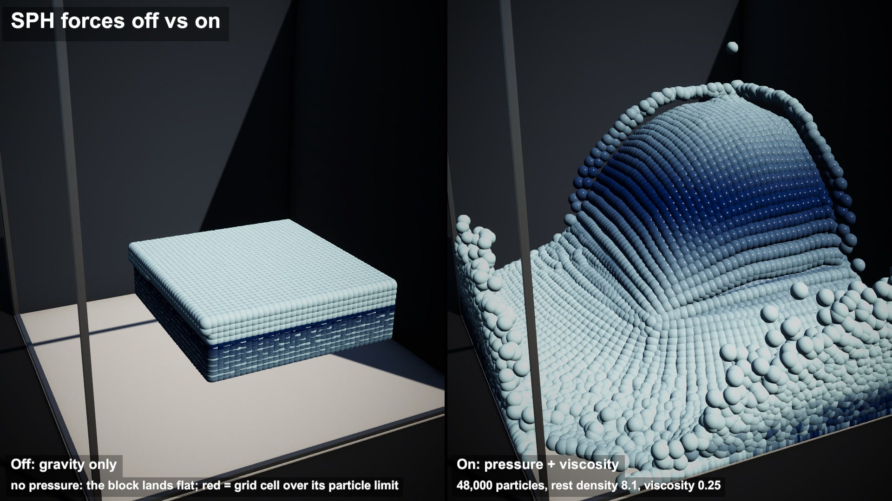

# SPH Fluid on the GPU

48,000 particles, no grid of velocities anywhere. Each one looks up its neighbours, works out how crowded it is, and pushes back. That alone turns a falling block into a wave. Particle SPH on the GPU, Unity URP.

## The problem

Liquid that splashes, folds over and settles is hard to fake with animation. A grid-based solver needs a velocity field over the whole volume. Smoothed particle hydrodynamics only needs the liquid itself: a cloud of particles, each carrying its own speed.

## How it works

This is a port of the compute shader path in Gornhoth's Unity SPH repo. Six kernels per step:

1. Clear a uniform grid and drop every particle into its cell.

2. Build each particle's neighbour list from 8 nearby cells, keeping those within the kernel radius.

3. Density: sum a smooth bell-shaped kernel over the neighbours. Pressure = stiffness x (density - rest density).

4. Forces: the pressure gradient pushes particles from crowded to sparse areas; viscosity pulls each particle's velocity toward its neighbours'. Add gravity.

5. Integrate with forward Euler and clamp to the box, losing half the speed on each wall hit.

No pressure solve and no grid of velocities: it is weakly compressible, and stiffness alone holds the volume.

## What I hit

With the repo's scene values, my block did not behave like a liquid. Its rest density of 2 sits far below the density of its own starting lattice, so every particle began under huge pressure and the block blew apart to fill the tank. I set rest density to what the lattice measures, 8.1.

Sparse particles got negative pressure and were yanked together. I clamp pressure at zero and add each particle's own share of the density.

The repo starts every particle moving down at 50 units per second, faster than this fluid's pressure can respond. The landing packed hundreds of particles into one grid cell. I start them at rest.

The grid cell was 4 x the particle radius. I use 2 x, the smallest the 8-cell search allows, so far fewer particles share a cell.

## My build

Unity 6.3 URP, compute shaders from the repo with those marked changes, my own instanced sphere shader coloured by speed.

48,000 particles 0.5 apart, kernel radius 1, stiffness 2000, viscosity 0.25, time step 0.0008, 36 steps per video frame.

Busiest cell: 141 particles (limit 256). With forces off, up to 592 pile into one cell and the repo marks them red.

About 400 MB of GPU buffers per simulation, almost all of it neighbour lists. No frame times measured.

## Trade-offs

Weakly compressible: the surface bobs and the liquid squashes a little under its own weight.

A tiny time step, so many steps per frame.

The neighbour lists reserve room for the worst case, which costs memory.

Particles are drawn as spheres, not a smooth surface.

## When to use it

Splashes, pours and small tanks of liquid where particles suit the look, or as the solver behind a surface renderer.

## Credits

Technique source: Gornhoth/Unity-Smoothed-Particle-Hydrodynamics, https://github.com/Gornhoth/Unity-Smoothed-Particle-Hydrodynamics, commit 2129e837b79a3bc401a9bff90e246aef04a0c896 (ComputeShader path). License: MIT, Copyright (c) 2021 Johannes Schatteiner.

Code reused: yes. The SPH compute shader (grid, neighbour lists, density and pressure, pressure and viscosity forces, integration and box boundary) is the source's code with marked changes: each particle's own density term, pressure clamped at zero, and a switch that turns the forces off for the comparison. The particle manager is my port of the source's: same parameters, buffers, spawn and kernel order, with a 2 x radius grid cell, several steps per frame, a start-speed parameter and restart support. The source credits Doyub Kim's fluid engine book and Müller, Charypar and Gross for the SPH formulas.

Engine: Unity 6.3 LTS, Universal Render Pipeline.

My own code: the instanced particle shader, the tank scene, the three side-by-side simulations and cameras, the comparison layout and labels.

No external models or assets. Character: none.

## Files

- `Editor/BuildScene.cs`
- `SPH/LICENSE.txt`
- `SPH/SPH3D.compute`
- `SPH/SPHFluid.cs`
- `SPHDirector.cs`
- `Shaders/SPHParticle.shader`

## Build the scene

In the Unity editor: **Vidar Game Lab > Techniques**, then **Build** next to `sph-fluid-gpu`. From the command line: `tools/capture.sh sph-fluid-gpu GameTech.Posts.SPHScene.Build`.
