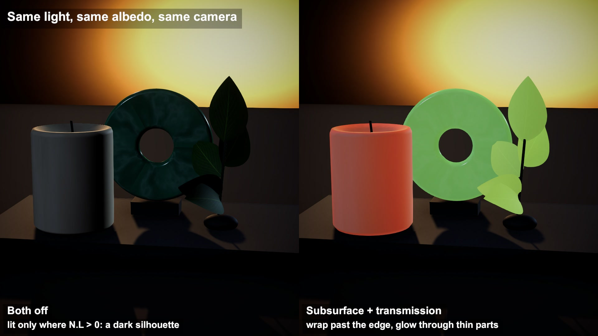

# Subsurface Scattering and Transmission

Put the sun behind a wax candle and normal lighting gives you a black cutout. Turn on subsurface scattering and transmission and the wax, jade and leaf start to glow from inside. Unity URP, side by side.

## The problem

Standard shading only lights a surface where it faces the light. Back-light a candle, a jade disc or a leaf and every pixel the camera sees faces away from the sun, so it goes dark. In real life thin or waxy things do the opposite: light enters, scatters inside and comes out the side you are looking at.

## How it works

This uses the lighting from Kink3d's kShading, an open-source shader pack for Unity's Universal Render Pipeline. Two cheap terms, each behind its own toggle:

1. Subsurface wrap. Normal diffuse is N·L clamped at zero. The wrap version adds the subsurface colour before clamping and divides by (1 + colour)², so light keeps going past the shadow edge and picks up that colour on the way.

2. Transmission. Bend the light direction slightly by the normal, then compare it with the view direction. When you look toward the light through the object, this term peaks.

3. Scale transmission by (1 − thickness). Thickness is a single number per material here: 0 lets the most light through, 1 blocks it.

No ray marching, no blur pass, no depth maps. It is a few extra lines in the per-light loop.

## What I hit

The pack targets URP from 2019 and Unity 6.3 has moved its lighting library, so I ported the two terms into my own small URP shader and kept everything else on the current library.

The source stores the wrap result in a single scalar, which silently keeps only the red channel. I kept it per channel.

My first lathe meshes had flipped triangles, so the camera saw the inside of the candle. With the sun at full strength, transmission washed everything into flat neon, so I brought the sun down and the thickness up.

## My build

Unity 6.3 URP. A wax pillar, a jade disc and a five-leaf sprig, all generated in code, on a slate pedestal.

Back sun 14° above the horizon, behind the objects, intensity 1.7, plus a weak cool fill and a rim light.

Thickness: wax 0.72, jade 0.55, leaf 0.40. The last shot sweeps all three from 0.95 to 0.05.

Two identical object sets, one per half of the frame, same camera move, same light, same albedo. Only the two toggles differ.

No GPU timings measured.

## Trade-offs

Thickness is a constant, so a thin rim and a thick core glow the same unless you bake a thickness map.

Transmission ignores the shadow map, so light passes through no matter what sits behind.

It looks right for back light and soft materials. It is not a physically based skin or volume model.

## When to use it

Foliage, candles, wax, jade, ears, paper lanterns, any small thin prop that gets back-lit in a cinematic shot. If you need real skin or thick volumes, use a screen-space or ray-traced subsurface model instead.

## Credits

Technique source: Kink3d/kShading, https://github.com/Kink3d/kShading, commit cc62b3bef6d781762248552571d7e68b1c413d82. License: MIT, Copyright (c) 2017 Matt Dean.

Code reused: yes, ported. The subsurface wrap lighting (Radiance) and the thickness-based transmission term (LightingExtended) from the source's Lighting.hlsl are re-implemented in my own Unity 6.3 URP shader with the same _SUBSURFACE and _TRANSMISSION toggles. The surrounding BRDF, global illumination and light loop use the current URP shader library, not the source's copies. Clear coat, anisotropy and toon shading from the same pack are not used.

Engine: Unity 6.3 LTS, Universal Render Pipeline.

My own code: the shader port, the procedural wax pillar, jade disc, leaf sprig, textures and pedestal, the two-set split-screen comparison, the thickness sweep, lighting, cameras and labels.

No external models or assets.

## Files

- `Editor/BuildScene.cs`
- `SSSDirector.cs`
- `Shaders/SSSLit.shader`

## Build the scene

In the Unity editor: **Vidar Game Lab > Techniques**, then **Build** next to `sss-transmission`. From the command line: `tools/capture.sh sss-transmission GameTech.Posts.SSSScene.Build`.
