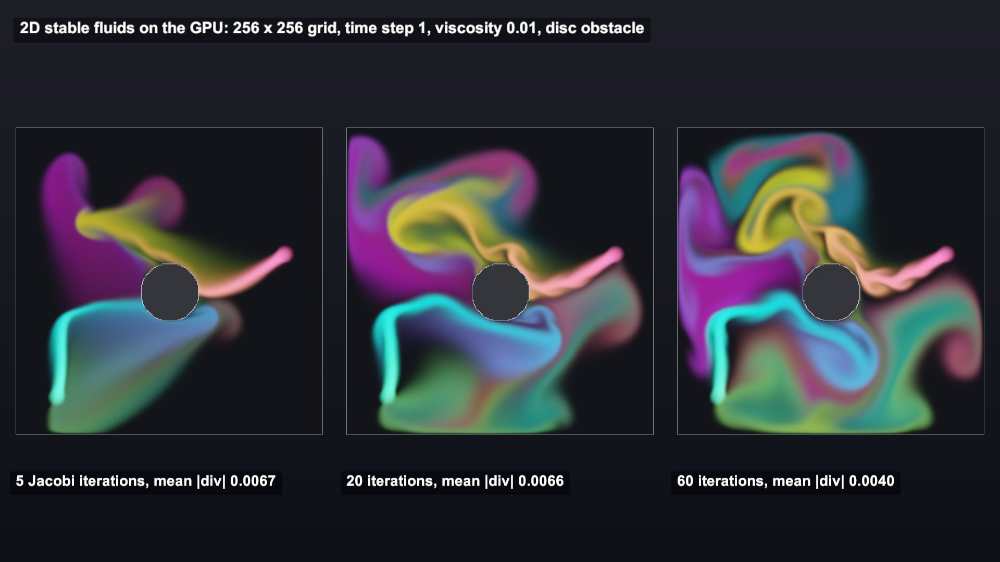

# 2D stable fluids with compute shaders: advect, diffuse, Jacobi pressure projection

Ink pushed by two jets around a disc on a 256 x 256 grid. Move it, blur it, then solve for pressure so the flow stays divergence-free. All compute shaders, every frame.

## The problem

Smoke and ink need a velocity field that moves itself, swirls around obstacles, and never squeezes or stretches the fluid. Solving that by hand per particle is slow. On a grid, a few GPU passes per frame get you there.

## How it works

This follows Shahriar Shahrabi's compute shader fluid solver for Unity, which builds on Jos Stam's stable fluids.

Each step:

1. Add force and dye at the jets.

2. Diffuse velocity: implicit viscosity, solved with Jacobi iterations.

3. Project: measure the divergence of the velocity, solve Laplace(p) = div(v) with Jacobi (each cell becomes the average of its 4 neighbours minus its divergence, over 4), then subtract the pressure gradient.

4. Advect velocity by itself: each cell looks back along its velocity and samples where the fluid came from.

5. Project again, then advect and diffuse the dye.

Boundary passes run between steps: walls flip velocity, and a lookup table handles cells next to the disc.

## What I hit

Without projection, nothing travels. Advection only looks backwards, so a cell in front of a jet has zero velocity, samples itself and stays at zero. The ink piles up at the jets. Pressure is what carries the push across the grid.

Jacobi converges slowly. Mean |divergence| left after projection, averaged over the run: 0.0062 at 5 iterations, 0.0057 at 20, 0.0037 at 60. Twelve times the work removes about 40% of the error, but the swirls visibly gain detail.

The source's diffusion feeds each new iterate back in as the right-hand side, so the blur grows with the iteration count. I keep the original field as the right-hand side.

URP never runs the source's camera command buffer, so I dispatch the kernels directly.

## My build

Unity 6.3 with URP on an Apple M4 Mac mini, Metal. The source's compute kernels are used unchanged; the C# orchestration is ported with the same kernel order and names.

Grid 256 x 256, time step 1, grid scale 1, viscosity 0.01. Dye fades by 0.996 per step, velocity by 0.999.

Peak speed is about 2.6 cells per step, peak pressure 0.4 to 0.9.

At 60 iterations one step runs 240 Jacobi dispatches.

I did not measure frame times, so I quote none.

## Trade-offs

2D only. A 3D grid multiplies memory and work by the depth.

Grid resolution sets the smallest eddy. Anything under a few cells is lost.

Semi-Lagrangian advection is stable but blurs: small vortices fade every step.

Pressure starts from zero each step, so fewer iterations means more leftover divergence and softer, leakier flow.

## When to use it

Interactive 2D smoke, ink and paint on a screen or a texture, wind maps for grass or fog, and menus that react to the cursor.

## Credits

Technique source: Compute-Shaders-Fluid-Dynamic- by Shahriar Shahrabi (IRCSS), https://github.com/IRCSS/Compute-Shaders-Fluid-Dynamic-, commit 03765e79d48ba7c2900532e1b9b140f5746b7ad6, MIT License, Copyright 2020 Shahriar Shahrabi. Its 2D stable fluids solver is used: the compute shaders for advection, divergence, pressure gradient subtraction, the Jacobi solver, wall and arbitrary-boundary handling, force and dye sources, buffer utilities and their shared include files are copied unchanged. The three arbitrary-boundary lookup tables from its C# generator are copied as data. Its C# simulation steps (diffuse, advect, project, boundary handling, sources) are ported with the same kernel order and names; the diffusion right-hand side is kept fixed instead of being fed the latest iterate. The repo's demo scenes, scripts other than the solver and the simple 2D sims, and all of its assets are not used.

Underlying method: stable fluids by Jos Stam (semi-Lagrangian advection, implicit diffusion, pressure projection), as implemented in the repo above.

Engine: Unity 6.3 LTS (6000.3.28f1) with the Universal Render Pipeline 17.3. Used for rendering. It is not the source of the technique.

My own code: the URP port of the simulation loop with direct compute dispatches, the scripted jets, the divergence readback, the view kernel for dye, velocity, pressure and divergence, the panel compositor, the stage scene built from code, the timeline, labels and video.

No external models or assets.

## Files

- `2DDrawingUtility.cginc`
- `Boundary_Handling.compute`
- `Editor/BuildScene.cs`
- `FluidCompose.shader`
- `FluidDirector.cs`
- `FluidDynamicCommonUniforms.cginc`
- `FluidDynamicUtility.cginc`
- `FluidView.compute`
- `Navier_Stokes.compute`
- `Solvers.compute`
- `StableFluidSolver.cs`
- `StructuredBufferUtility.compute`
- `UserInput.compute`

## Build the scene

In the Unity editor: **Vidar Game Lab > Techniques**, then **Build** next to `stable-fluids-2d`. From the command line: `tools/capture.sh stable-fluids-2d GameTech.Posts.FluidScene.Build`.
