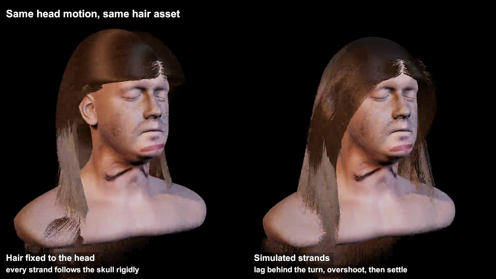

# Strand Hair Simulation: Rigid vs Simulated

30,000 simulated hair strands in Unity that lag behind a fast head turn, collide with the head and shoulders, and settle. In the preview the left head has the same hair locked to the skull, the right head has it simulated.

## The problem

Most game hair is a handful of cards skinned to the head. Turn fast and the whole hairstyle turns with the skull like a helmet. Real hair lags behind the turn, swings past, hits the neck and shoulders, and comes to rest a moment later. Getting that means simulating thousands of separate strands on the GPU every frame.

## How it works

This uses Unity's Demo Team Hair package, the strand system built during their Enemies short.

1. Each strand is a chain of particles. A strand is resampled to 24 particles from root to tip.

2. Every step, the solver moves the particles freely, then pulls them back with constraints: fixed segment length, a local shape pull that keeps the curl of the rest groom, and a global rotation pull near the root so the style does not collapse.

3. Particles that end up inside a collider (spheres and capsules on the head, neck and shoulders) are pushed back out, with friction.

4. Roots are glued to the skull. The tips are free, so they trail behind any turn and swing back.

5. Each strand is drawn as a camera-facing ribbon and lit with two shifted specular lobes, so highlights slide along the hair as it moves.

## What I hit

The package's default hair materials drew nothing in my capture setup, so I wrote a small strand shader on top of its unlit vertex path.

My first combs flared out like wings or fell over the face. I rewrote the groom generator to comb strands along the scalp first, then let them hang.

Too much shape stiffness and the hair moved like a helmet. Too little and it collapsed. The balance that worked: local shape 0.15 plus a root-weighted global rotation of 0.3, no damping.

## My build

Unity 6.3 URP on an M4 Mac mini. Head: a free CC BY 3.0 head scan by Lee Perry-Smith.

30,000 strands, 24 particles each, solver at 90 Hz with 4 constraint iterations.

Same head motion, same hair asset on two heads: one with the hair locked to the skull, one simulated.

Measured tip offset between the two during the comparison: about 3 cm at rest from gravity sag, up to 8.6 cm on average across all tips during a fast turn, peak single tip 17.6 cm.

No frame times measured; the video is an offline capture.

## Trade-offs

Tens of thousands of strands is GPU work every frame, fine for a hero character, too much for a crowd.

Colliders are simple spheres and capsules, not the exact shape of the head.

Strands do not collide with each other one by one, and the groom is generated, not made by an artist.

## When to use it

Cinematics, character close-ups, hero characters in third-person games: anywhere a head turns fast on camera. For background NPCs, keep hair cards.

## Credits

Technique source: Unity-Technologies/com.unity.demoteam.hair (Unity Demo Team Hair), https://github.com/Unity-Technologies/com.unity.demoteam.hair, commit 75a7f446209896bc1bce0da2682cfdbdf30ce447, version 0.19.0-preview.1. License: Unity Companion License (com.unity.demoteam.hair copyright © 2020 Unity Technologies ApS, licensed under the Unity Companion License for Unity-dependent projects). Not MIT.

Code reused: yes, as a package. The strand solver (constraints, collision, LOD clusters), the hair asset and instance builders and the strip renderer with its unlit vertex path are the source package, installed unmodified at that commit. My code builds the groom, the scene and the comparison, and adds my own strand shader on top of the package's vertex path.

Head model: "Infinite, 3D Head Scan" by Lee Perry-Smith, CC BY 3.0 (https://creativecommons.org/licenses/by/3.0/). Based on a work at www.triplegangers.com, permissions beyond the license at http://www.ir-ltd.net/. Obtained from the three.js repository, examples/models/gltf/LeePerrySmith (https://github.com/mrdoob/three.js). Changes: converted from glTF to OBJ, scaled, and a dark scalp cap mesh added under the hair. Colour and normal textures unmodified.

The posted video opens with a short GTA VI trailer clip (© Rockstar Games) on the left half as a visual reference. It is not part of the technique and is not included here; in this scene the first 3.7 s render only the right half of the frame.

Engine: Unity 6.3 LTS, Universal Render Pipeline.

My own code: the groom generator (scalp-following comb, then hang, with head and shoulder constraints), the Kajiya-Kay style strand shader, the head and collider setup, the rigid-vs-simulated comparison, the tip offset measurement, cameras, lighting, layout and labels.

Character: none; the head is the scan credited above.

## Files

- `Editor/BuildScene.cs`
- `HairDebug.cs`
- `HairDirector.cs`
- `HairGroom.cs`
- `Head/Head.obj`
- `Head/Infinite-Level_02_Tangent_SmoothUV.jpg`
- `Head/LeePerrySmith_License.txt`
- `Head/Map-COL.jpg`
- `Shaders/HairStrandKK.shader`

## Requires

Unity's Demo Team Hair package (Unity Companion License), at commit `75a7f44`. Add it in the Package Manager from the git URL `https://github.com/Unity-Technologies/com.unity.demoteam.hair.git#75a7f446209896bc1bce0da2682cfdbdf30ce447`. It is not copied into this folder, and the scripts here do not compile without it.

The head scan in `Head/` is included under CC BY 3.0 with its original license text (`Head/LeePerrySmith_License.txt`).

## Build the scene

In the Unity editor: **Vidar Game Lab > Techniques**, then **Build** next to `strand-hair-sim`. From the command line: `tools/capture.sh strand-hair-sim GameTech.Posts.HairScene.Build`.
