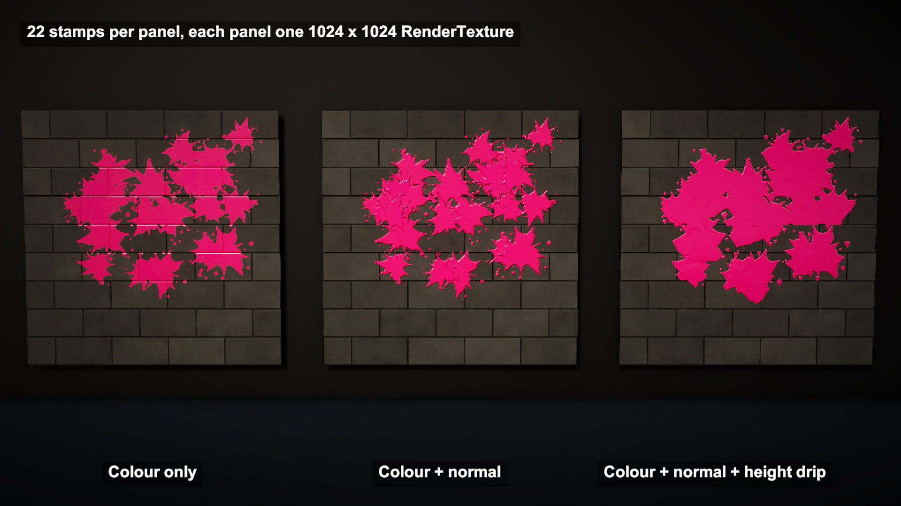

# Ink painted into each object's own texture

Ink blobs hit a wall, a barrel, a twisted column and a sphere. The paint goes into each object's own texture, wraps around the curves and never fades.

## The problem

The quick way to leave paint at a hit is a decal: a small quad placed on the surface. On a sphere a flat quad sticks out past the edges, and each one is another draw, so most games delete them after a few seconds.

## How it works

This follows EsProgram's InkPainter for Unity. Every paintable object gets its own RenderTexture, copied from its base texture, and its material shows that instead.

When a blob hits, a ray cast against the mesh collider returns the UV coordinate of the hit point. A paint shader then runs over the whole texture. Pixels inside a rotated square around that UV blend in the brush shape with the ink colour, the rest copy through, and the result is copied back.

The ink lives in texture space, so it wraps over curves like any texture.

The same stamp goes into the normal map, which gives the ink raised edges that catch the light, and into a height map. On the drip panel a pass runs every frame: each pixel looks a little way up and pulls the ink down if the ink above is thick enough. Two more passes turn height into colour and normals.

## What I hit

The source sizes the brush in UV units. My wall is 8 x 4.5 m squeezed into one UV square, so a square brush came out stretched. I convert the UV offset to metres before the brush test.

The sphere has a UV seam. A stamp near u = 1 does not continue at u = 0, so it gets cut along a straight line. The debug view shows both halves at opposite edges of the texture.

UVs must not overlap. Unity's built-in cube maps all six faces onto one square, so one hit paints every face. My meshes are built with their own UV layout.

The drip keeps one ink colour. A new colour stops the old drip, as in the source.

## My build

Unity 6.3 with URP on an M4 Mac mini. InkPainter's paint, normal, height, drip and conversion shaders are rewritten as one URP shader with one pass each, with the same blend maths.

Texture sizes: wall 2048 x 1152, about 4 mm per pixel. Floor 2048 x 2048. Sphere and barrel 1024 x 512, column 512 x 1024, each panel 1024 x 1024.

141 stamps in the video, brush squares 32 to 76 cm wide, 4 brush shapes generated from code with matching normal and height maps.

Each stamp is two copies per map: through the paint shader into a temporary texture and back.

## Trade-offs

Memory: every painted object keeps its own maps. The wall alone is 9.4 MB per map.

Resolution is fixed per object.

Seams cut stamps unless you paint both sides.

One ray hit gives one UV, so ink that should run around an edge onto the next face stops at the edge.

The drip moves a fixed distance per frame, so its speed depends on frame rate.

## When to use it

Paint, mud, scorch marks or snow that must stay for the whole session, on meshes with clean, non-overlapping UVs.

## Credits

Technique source: InkPainter by Es_Program (EsProgram), https://github.com/EsProgram/InkPainter, commit 508aefe9466db3343fdd6dfd78c4598ab979fd94, MIT License, Copyright (c) 2017 Es_Program. Its paint path (one RenderTexture per map, paint at the hit UV, blit through the paint shader and back), the PaintMain, PaintNormal and PaintHeight blend maths, and the HeightFluid drip (HeightDrip, HeightToColor, HeightToNormal, InvertAlpha) are rewritten for URP. The repo's sample scenes, models, textures and brush images are not used.

Engine: Unity 6.3 LTS (6000.3.28f1) with the Universal Render Pipeline 17.3. Used for rendering. It is not the source of the technique.

No external models or assets: meshes, base textures and brushes are generated from code.

My own code: the URP shader passes, the brush measured in metres, the decal-quad comparison, the scene, ink blobs, timeline, labels and video.

## Files

- `Editor/BuildScene.cs`
- `InkDecal.shader`
- `InkDirector.cs`
- `InkPaint.shader`
- `InkSurface.cs`

## Build the scene

In the Unity editor: **Vidar Game Lab > Techniques**, then **Build** next to `texture-painting`. From the command line: `tools/capture.sh texture-painting GameTech.Posts.TexturePaintScene.Build`.
