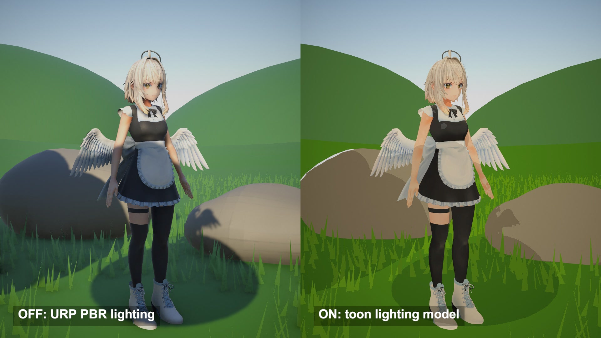

# Toon shader: flat light bands, rim light, stepped specular

Toon lighting in the style of Breath of the Wild, rebuilt in Unity from Ciro Continisio's shader graph. The light's brightness is thrown away and replaced by 3 flat bands.

## The problem

Standard lighting gives a smooth falloff from light to dark. On a stylised character that gradient reads as plastic. A toon look wants a few flat tones with clean edges and highlights that look painted.

## How it works

This follows Ciro Continisio's recreation of the game's look, a Shader Graph built around a custom lighting model.

The dot product of normal and light direction (N·L) is remapped from -1..1 to 0..1 and sampled through a stepped gradient. Below 0.08 the value is 0.45. Up to 0.65 it is 0.66. Above that it is 1.0, so the fully lit band starts at N·L 0.31.

The light colour is converted to HSV and its V is replaced by that band value. The light keeps its hue and loses its brightness.

Two rims sit on top, and both compare a Fresnel term against a threshold. One appears on the lit side. The other appears when the sun is behind the subject, and the Backlight Amount (2.3 in the source) sets its width.

The highlight is Blinn-Phong with exponent 32, multiplied by a brush-dab texture. Anything above 0.01 becomes one flat grey, so it breaks into strokes.

Cast shadows go through the same band lookup: brightness is the smaller of N·L and the shadow term.

## What I hit

A sun-facing surface in cast shadow gets a brightness near 0, which remaps to 0.5 and lands in the middle band. So a cast shadow has the same tone as a surface turned a little away from the sun, and the darkest band only shows where N·L is below -0.84.

With the sun 75 degrees to her side, the character's whole front sat below 0.31 and looked flat. I moved the sun to 40 degrees.

The rim also flooded the ground white, because flat terrain is seen at a grazing angle. I added a per-material switch and turned the rims off for terrain and grass.

## My build

Unity 6.3 with URP, rendered on an Apple M4 Mac mini. The source targets URP 12. I rewrote the graph as one HLSL shader with the source's gradient keys and parameter values, plus a stage value that turns the layers on one at a time for the video. The comparison side runs URP's own PBR lighting on the same meshes and textures.

The dab texture is generated in code. The scene is a 180 x 180 terrain grid, 9,000 grass triangles, rocks and a tree just out of frame whose shadow falls across her. No assets from the game or from the source project appear.

## Trade-offs

The model reads one directional light. The source lists point lights, spot lights, baking and reflection probes as missing, and my port has no ambient term either. Light intensity does nothing to the diffuse tone, so exposure is set through the band values. A mesh with noisy normals gets a noisy edge between bands.

## When to use it

Outdoor scenes with one strong sun and stylised characters. Interiors lit by many small lights need a loop over those lights first.

## Credits

Technique source: BotW-ToonShader by Ciro Continisio (ciro-unity), https://github.com/ciro-unity/BotW-ToonShader, commit 2972e15d3ec0adf7fa097f8c176c0da9026acb84. The shaders in its Shaders folder are released into the public domain (Unlicense text in the repo's LICENSE). Rewritten in HLSL from the 5_ZeldaToon Shader Graph and its MainLightModel_Normals, GetMainLight and DirectSpecular sub-graphs, with the graph's gradient keys and parameter values. The repo's 3D assets (Unity Creator Kit, Asset Store licence) and its dab texture are not used. The repo is a fan recreation of the toon look of The Legend of Zelda: Breath of the Wild. This post has no connection to Nintendo and uses no Nintendo assets.

Engine: Unity 6.3 LTS (6000.3.28f1) with the Universal Render Pipeline 17.3. Used for rendering, and its PBR lighting is the comparison side. It is not the source of the technique.

Character: モデル：葉葉波、キャラクターデザイン：えびごはん (©はっぱろぐ！・えびごはん・EAUploader). Fan-made reproduction, not official. #いあ3D

My own code: the HLSL port with its stage switch and rim switch, the generated dab texture, the terrain, grass, rocks and tree, the pose and idle motion, camera moves, labels and video.

## Files

- `Editor/BuildScene.cs`
- `ToonDirector.cs`
- `ZeldaToon.shader`

## Build the scene

In the Unity editor: **Vidar Game Lab > Techniques**, then **Build** next to `toon-shader`. From the command line: `tools/capture.sh toon-shader GameTech.Posts.ToonScene.Build`.

This scene uses the IA character model, which is not in this repository. See the main README.
