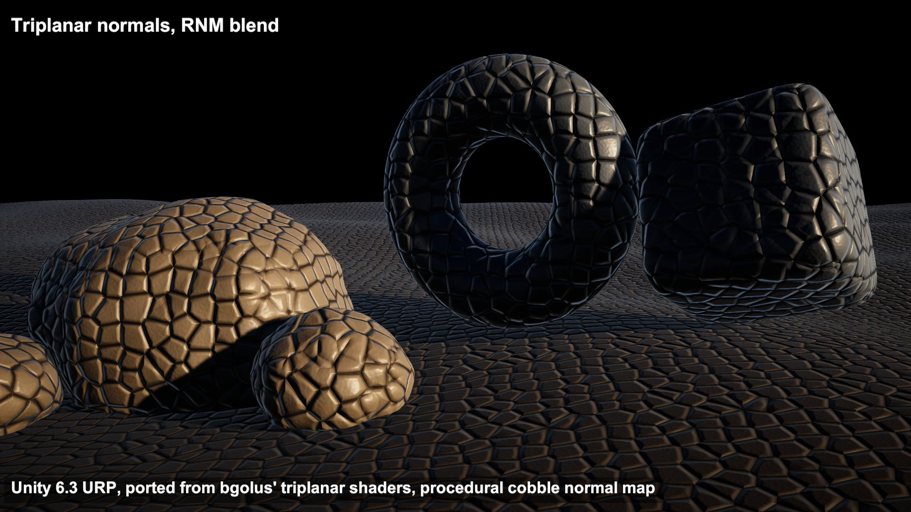

# Triplanar Normal Mapping

No UVs on these meshes: one normal map projected along X, Y and Z. Blend the 3 samples naively and 35% of bumps on a test sphere lean the wrong way. Turn each onto the surface first and they shade right.

## The problem

Triplanar mapping textures a mesh without UVs: project the texture along world X, Y and Z and blend by the surface normal. Colour just works. Normal maps do not. A tangent-space normal only means something inside its own frame, and each projection has a different one. Blend the three samples and push the result through the mesh's tangents, and the bumps lean the wrong way wherever those frames disagree.

## How it works

This follows bgolus' triplanar normal mapping shaders.

1. Blend weights: the surface normal's components to the 4th power, normalised.

2. Three planar UVs from world position. On faces that point the negative way along an axis, U and the sample's x are flipped so the map is not mirrored.

3. Each sample's frame is two world axes, so swizzle it into world space and combine it with the surface normal. GPU Gems 3 adds the sample's slope to the normal. Whiteout also scales by the sample's z. RNM rotates the sample so its "up" becomes the surface normal.

4. Blend the three results by the weights and normalise.

## What I hit

The source is five small built-in pipeline shaders lit by one light. I moved the projection and all five blends into one URP lit shader, so shadows and specular come from URP.

My meshes have no UVs, so the naive version needed some tangent frame. I gave it a top-down one. It is right on the ground and wrong on the sides, which is the whole failure.

UDN and GPU Gems 3 measured the same error to two decimals. Per projection they are the same vector written two ways.

I lowered the colour contrast between cobble and gap, so the shading, not the colour, shows the shape.

## My build

Unity 6.3, URP 17.3, Forward+, Metal on an M4 Mac mini. 1920x1080, 30 fps.

Ground, three noise rocks, a torus and a rounded block, all built in code. One 512 px cobble normal map, also generated, height in alpha, one repeat per metre. Low sun at 17°, 4096 shadow map.

CPU test with the shader's maths on 39,192 points of a sphere, average bump tilt 21.9°. Mean error against a slope reference: naive 23.5°, GPU Gems 3 4.7°, Whiteout 3.7°, RNM 2.2°. Bumps leaning the wrong way: naive 35%, the others 0%.

The reference is my choice: each projection's slope laid onto the surface, blended by the same weights.

No frame times measured.

## Trade-offs

Three texture reads per map instead of one.

On 45° surfaces two projections cross-fade, and the pattern doubles there.

RNM is the closest here but costs a few more instructions than Whiteout.

## When to use it

Rocks, cliffs, terrain, voxel and procedural meshes, sculpts without UVs. If a mesh has good UVs, use them.

## Credits

Technique source: Normal-Mapping-for-a-Triplanar-Shader by bgolus (Ben Golus), https://github.com/bgolus/Normal-Mapping-for-a-Triplanar-Shader, commit a3571bf5f6e857e85c2f37875e79568282277de8. License: Unlicense (public domain dedication). Used: the triplanar projection, the UV flip for back-facing sides and the naive, UDN, Whiteout, RNM and GPU Gems 3 normal blends from the shaders TriplanarNaive, TriplanarUDN, TriplanarWhiteout, TriplanarRNM and TriplanarGPUGems3, ported to one URP shader in HLSL. The repo's surface shader, swizzle and reconstructed-tangent variants are not used.

Engine: Unity 6.3 LTS (6000.3.28f1) with the Universal Render Pipeline 17.3, Forward+. It is the renderer, not the source of the technique.

My own code: the URP lit shader around the ported blends, the procedural cobble normal map, the ground, rocks, torus and rounded block built from code, the CPU blend test, the split-screen comparisons, labels and video.

No external models or assets.

## Files

- `Editor/BuildScene.cs`
- `LICENSE-triplanar.txt`
- `TriplanarCommon.hlsl`
- `TriplanarDirector.cs`
- `TriplanarLit.shader`

## Build the scene

In the Unity editor: **Vidar Game Lab > Techniques**, then **Build** next to `triplanar-normals`. From the command line: `tools/capture.sh triplanar-normals GameTech.Posts.TriplanarScene.Build`.
