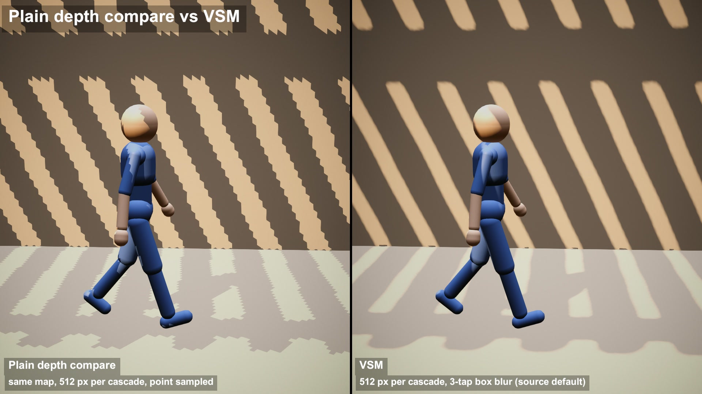

# Variance Shadow Maps

Same 512 px shadow map, two ways to read it. A plain depth compare gives stair-stepped edges. Variance shadow maps store depth and depth squared, blur them, and the edge turns into a soft ramp. Unity URP.

## The problem

A normal shadow map stores one depth per texel and answers yes or no. At low resolution that answer shows up as steps along every edge. Filtering the map itself does not help: averaging depths and then comparing still gives a hard yes or no. Softening has to happen at lookup time, with many samples per pixel.

## How it works

This is a port of arigo's ShadowVSM.

1. Render the scene from the sun into a float texture: depth in one channel, depth squared in the other.

2. Blur that texture like any image, in two passes (vertical, then horizontal). After the blur each texel holds the mean depth and the mean squared depth of its neighbourhood.

3. On a receiving pixel, variance = mean of squares - square of mean. Chebyshev's inequality then gives an upper bound on how much of that neighbourhood is farther from the light than the pixel: variance / (variance + distance²).

4. The source then remaps that bound with a smoothstep from 0.75 to 1, which trades some softness for less light leaking.

5. Cascades: six boxes on the sun's rotation, each twice the size of the one before. A pixel picks the smallest box it falls in.

## What I hit

The source runs only in Unity's built-in pipeline and renders its depth through a camera with a replacement shader. URP has neither, so I draw the casters with a command buffer before the frame, using a depth shader that projects with the same matrix the receivers read.

I store the six cascades as slices of a texture array instead of rows of one tall texture, so the blur cannot pull in a neighbouring cascade.

The source's default depth range is 1,000 units each way. In a small courtyard that leaves too little depth precision for the variance test, so I set it to 20.

## My build

Unity 6.3 URP, my own small lit shader that multiplies sunlight by the VSM term, ambient from spherical harmonics.

Source defaults: 512 px per cascade, 6 cascades, first box 16 m across, so about 3 cm per texel in this scene.

Each blurred version of the map is 12 MB (6 slices, two 32-bit floats per texel). 288 caster draws per update.

The figure is a stand-in mannequin built from capsules.

No frame times measured.

## Trade-offs

Light bleeding: where several casters overlap at different depths the bound gets loose. The source's remap hides most of it.

A wider blur is not free softness. With the source's 21-tap option, the thin stripes on the wall merge into one dark band.

Two float channels per texel cost more memory than a depth-only map.

## When to use it

Low-resolution or mobile shadow maps, static or slowly updated shadows you blur once and reuse, and scenes where soft edges matter more than contact accuracy.

## Credits

Technique source: arigo/ShadowVSM, https://github.com/arigo/ShadowVSM, commit 2b90f07f9160f686c3215ccd8b03e191a27ef247. License: MIT, Copyright (c) 2022 Armin Rigo.

Code reused: yes. The two-pass blur shader is the source's shader with marked changes (the large-blur switch became a keyword, and a 1-tap mode was added for the plain depth compare). The shadow component, the depth pass and the receiver function are my URP ports of the source's code: same cascades, light matrices, depth and depth-squared output, normal offset, Chebyshev test and smoothstep remap. Changes: casters drawn with a command buffer instead of a replacement-shader camera, cascades stored in a texture array, and the cascade index clamped to the last one.

Engine: Unity 6.3 LTS, Universal Render Pipeline.

My own code: the lit shader that applies the shadow term, the plain depth compare used for the comparison, the per-camera switches, the courtyard scene, the stand-in mannequin's motion, the comparison layout and labels.

No external models or assets. Character: a stand-in mannequin built from code.

## Files

- `Editor/BuildScene.cs`
- `Shaders/VSMLit.shader`
- `ShadowVSM/BlurShader.shader`
- `ShadowVSM/LICENSE.txt`
- `ShadowVSM/ShadowVSMURP.cs`
- `ShadowVSM/ShadowVSMURP.hlsl`
- `ShadowVSM/VSMDepthURP.shader`
- `VSMDirector.cs`

## Build the scene

In the Unity editor: **Vidar Game Lab > Techniques**, then **Build** next to `variance-shadow-maps`. From the command line: `tools/capture.sh variance-shadow-maps GameTech.Posts.VSMScene.Build`.
