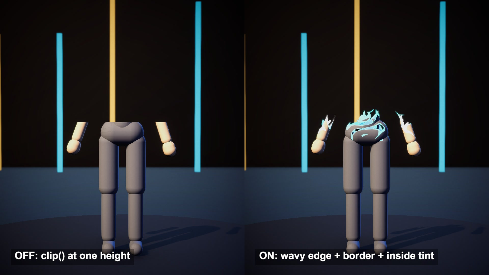

# Vertical dissolve with a glowing edge

A character cut away along a moving height line, after AdultLink's Vertical Dissolve shader. Noise-driven sine waves bend the cut, and a glowing band rides along its edge.

## The problem

The cheapest dissolve is one line of shader code: discard every pixel above a height. The result is a flat slice, as if a plane passed through the model. You look into an empty shell, and the edge gives no hint of energy or material.

## How it works

The source builds a bent height for every pixel. It starts from the pixel's Y and adds two sine waves, one running along X and one along Z. 3D simplex noise scrolls through the model and shifts the phase of both waves, so the edge crawls.

That height is compared with the fill value twice. The first step keeps everything below the fill line. The second step is the same test moved down by the border width. Subtract one from the other and a thin band is left, which is painted with an HDR border colour.

Back faces get a flat fill colour, so the hollow inside reads as a glowing volume. An invert switch flips the kept side. A second switch chooses vertex or world coordinates.

## What I hit

Fill runs from 0 to 1, and the shader maps that to a height between -1 and 1 metre. A character standing on the origin sits in the top half of that range, and the head stays above the highest fill line. I lowered the stage so the model sits around the origin.

The noise never touches the height directly. It only enters inside the sine terms, so with wave amplitude 0 the noise sliders do nothing.

A border colour at HDR 3.0 clipped to white after tone mapping. At 1.9 it stays cyan.

A skinned character has no steady vertex coordinates, so the character uses world coordinates. I compare the two modes on rigid pods.

Shadow and depth passes need the same clip, or the removed half still casts a shadow.

## My build

Unity 6.3 with URP on an Apple M4 Mac mini. The source is an Amplify surface shader for the built-in pipeline. I rewrote its mask, border and inside tint in HLSL with the same property names, and copied its simplex noise function.

The character is 1.39 m tall. Fill sweeps from 0.87 to 0.20 and back. The border is 0.35, which is 3.5 cm, since the shader multiplies it by 0.1. Noise scale is 4 and both wave amplitudes are 0.04. Later shots compare border 0.35 and 1.0, noise scale 4 and 10, wave amplitude 0.04 and 0.12, and a blue and an orange inside tint.

## Trade-offs

There is no cap on the cut. The inside is a flat tint on back faces, with no thickness. Culling is off, so every back face is shaded. The edge is a hard alpha test and needs anti-aliasing from elsewhere. Nested clothing layers all show their own edge.

## When to use it

Spawn and teleport effects, or build-up reveals for props and scenery.

## Credits

Technique source: VerticalDissolve by AdultLink (Guillermo Angel), https://github.com/AdultLink/VerticalDissolve, commit d3383f6916d8575693d78d91cf90b192acc20f28, MIT License, Copyright (c) 2018 Guillermo Angel. The height mask, border band, inside tint, invert switch and coordinate switch of its shader are re-implemented in my own HLSL shader with the same property names. Its simplex noise function is copied from the shader file. The repo's models, textures and scenes are not used.

Engine: Unity 6.3 LTS (6000.3.28f1) with the Universal Render Pipeline 17.3. Used for rendering. It is not the source of the technique.

My own code: the URP lighting, shadow and depth passes around the mask, the stage and pods built from code, the timeline, camera moves, labels and video.

## Files

- `DissolveDirector.cs`
- `Editor/BuildScene.cs`
- `VerticalDissolve.shader`

## Build the scene

In the Unity editor: **Vidar Game Lab > Techniques**, then **Build** next to `vertical-dissolve`. From the command line: `tools/capture.sh vertical-dissolve GameTech.Posts.DissolveScene.Build`.

The character in the video is not included in this repository. Without it the scene builds a simple stand-in mannequin. To use your own model, see the main README.
