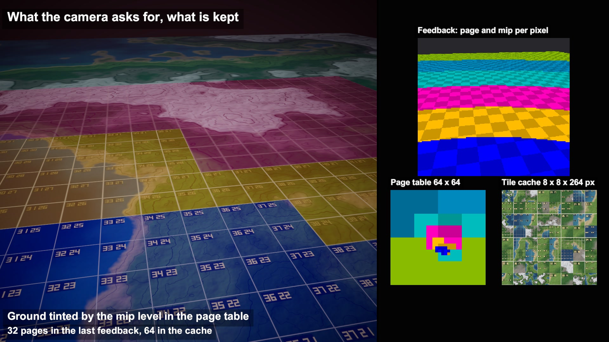

# Virtual Texture

A 16,384 x 16,384 texture on the ground, and the GPU holds 17 MB of it. A feedback pass finds the pages the camera needs, a page table points into a 64-tile cache, and the rest is never drawn.

## The problem

Spread 2,048 x 2,048 over 64 m and you get 32 pixels per metre: fine from the air, mush at your feet. 8x sharper is 64x the pixels, about 1.3 GB with mips. Most of it is off screen or far away at any moment.

## How it works

This follows jintiao's VirtualTexture.

1. The texture is cut into a 64 x 64 grid of 256 px pages, plus coarser mip levels where one page covers 2x2, 4x4 and so on.

2. Feedback: the ground is drawn again into a small buffer. Each pixel writes which page it hits and which mip level its screen footprint needs.

3. It is read back to the CPU without stalling the frame. If only a coarser page is loaded, the next finer one is queued.

4. Pages go into a tile cache, one fixed texture. When full, the least recently used tile is reused.

5. A 64 x 64 page table says which tile holds each page, at which mip. The ground shader reads it, then samples the tile.

This is not mipmapping, not blending textures to hide repetition and not a height offset. It is paging.

## What I hit

The source uses the built-in pipeline and a second camera with a replacement shader for feedback. In URP I draw it with a command buffer.

The source loads baked page files. I draw each page with a shader: a noise map, contour lines and the page's column and row number, so you can read which page loaded.

The capture renders off screen, so the camera reported the wrong size and feedback asked for pages 1.6 mips too coarse. Passing the output size in fixed it.

## My build

Unity 6.3, URP 17.3, Metal on an M4 Mac mini. 1920x1080, 30 fps.

Virtual texture 16,384 x 16,384 on a 64 m ground: 64 x 64 pages of 256 px (264 px with a 4 px border), 7 mip levels, 256 px per metre.

Feedback at quarter resolution (480 x 270 full screen), read back at half: 240 x 135. At most 8 page draws per frame.

Cache: 8 x 8 tiles, 2,112 x 2,112, 17.0 MB. Page table 16 KB.

Comparison: a regular 2,048 x 2,048 texture with mips, 21.3 MB, 32 px per metre.

Feedback asked for 16 to 51 different pages per readback.

Near ground in the split shot: mean difference between neighbouring pixels 2.1 levels (regular) vs 7.0 to 7.4 (virtual).

Fast 5 s pan: the 16-tile cache (4.3 MB) redrew 929 pages and still showed wrong and blurry pages. The 64-tile cache redrew 84.

No frame times measured.

## Trade-offs

Latency: a page arrives a frame or more after it is first needed, so fast motion shows coarse pages first.

A cache smaller than the view thrashes: pages evict each other every frame.

Every sample pays an extra lookup, and the tile border limits filtering: no blending between mips.

## When to use it

Huge unique terrains, maps, painted or decal-heavy worlds, anything where one texture would never fit. For a small level or tiling materials, regular textures with mips are simpler.

## Credits

Technique source: VirtualTexture by jintiao, https://github.com/jintiao/VirtualTexture, commit 18b8d2952fa2320d166a550bb012bfaaeb52f0ac. License: Apache-2.0 (the repository has no copyright line and no NOTICE file). Used: the page quadtree, page payload, LRU cache, load request and scale factor scripts unchanged; the page table, tiled texture and feedback reader scripts and the shader code for page lookup, feedback and mip colours ported to URP with changes (marked in the code). The feedback renderer and file loader were replaced by my own versions.

Engine: Unity 6.3 LTS (6000.3.28f1) with the Universal Render Pipeline 17.3. It is the renderer, not the source of the technique.

My own code: the URP feedback pass, the procedural page content (noise map, contour lines, page grid and numbers), the ground and debug view shaders, the regular-texture comparison, the scene, cameras, labels and video.

No external models or assets.

## Files

- `Editor/BuildScene.cs`
- `Shaders/VTDebugView.shader`
- `Shaders/VTGround.shader`
- `Shaders/VTPage.shader`
- `Shaders/VTPageContent.hlsl`
- `VTDirector.cs`
- `VirtualTexture/FeedbackReader.cs`
- `VirtualTexture/FeedbackRendererURP.cs`
- `VirtualTexture/LICENSE.txt`
- `VirtualTexture/LoadRequest.cs`
- `VirtualTexture/LruCache.cs`
- `VirtualTexture/PagePayload.cs`
- `VirtualTexture/PageTable.cs`
- `VirtualTexture/ProceduralLoader.cs`
- `VirtualTexture/ScaleFactor.cs`
- `VirtualTexture/Shaders/VTCommon.hlsl`
- `VirtualTexture/Shaders/VTFeedback.shader`
- `VirtualTexture/Shaders/VTFeedbackDownScale.shader`
- `VirtualTexture/TableNode.cs`
- `VirtualTexture/TiledTexture.cs`
- `VirtualTexture/VTBinding.cs`

## Build the scene

In the Unity editor: **Vidar Game Lab > Techniques**, then **Build** next to `virtual-texture`. From the command line: `tools/capture.sh virtual-texture GameTech.Posts.VTScene.Build`.
