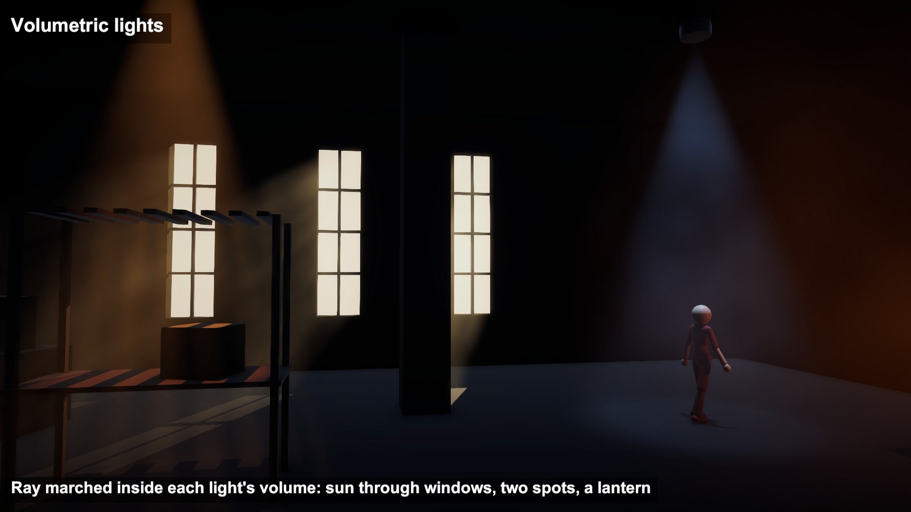

# Volumetric Lights

A spotlight in a dark room only lights the floor. Real air glows along the beam. Here every light ray-marches its own volume, checks its shadow map at each step, and the beam breaks where the slats block it.

## The problem

Normal lighting only happens on surfaces. The air between a lamp and the floor stays black, so a spotlight is a bright circle with nothing above it. Dust and haze scatter some light toward the eye, which is what makes a beam visible. Full-screen fog fills the room evenly. I want light only inside each lamp's volume, cut by whatever blocks it.

## How it works

This follows SlightlyMad's VolumetricLights.

1. For each pixel, take the view ray up to the depth buffer and clip it to the light's shape: sphere for a point light, cone for a spot, the whole ray for the sun.

2. March that segment in a few steps. Each step multiplies the light's falloff, its shadow map, a density from moving 3D noise, a scattering coefficient and a forward-scattering phase function.

3. Extinction adds up along the way, so far parts fade.

4. An 8x8 pattern shifts the first step per pixel. A depth-aware blur turns it into smooth haze instead of slices.

5. All of it runs at half resolution. A depth-aware upsample keeps beam edges on the objects, then it is added to the scene.

It is light inside each lamp, not fog in the whole room and not particles.

## What I hit

The source is a Unity 5 built-in pipeline project that draws each light's volume mesh from light and camera events. URP has neither, so I rewrote it as one renderer feature with full-screen passes and an exact sphere/cone interval in the shader. Spot shadows come from URP's shadow atlas by light index.

Two bugs cost the most time. URP already declares the shared samplers, and a second copy silently broke the shader on Metal. And pooled pass data kept every frame's light list, so the count grew into the thousands.

With volume shadows off the sun lit the air inside the closed hall, so that comparison shows the spot alone.

## My build

Unity 6.3, URP 17.3, Forward+, Metal on an M4 Mac mini. 1920x1080, 30 fps. Volume buffer 960x540.

A closed hall built from code, three windows, a slatted shelf, crates, a walking stand-in mannequin. Four volumetric lights: sun, two spots, a lantern. 8 samples per ray, the source's default. My own 64³ noise texture.

Measured on video frames, mean brightness of the half frame out of 255:

Volumetrics off 18.6, on 25.4.

Spot volume shadows off 16.1, on 12.0. About 20% of pixels change by more than 8 levels.

4 and 8 samples against 32: on average under 1 level apart. The dither and blur hide the steps.

No frame times measured.

## Trade-offs

One full-screen march per light, so the cost grows with the light count.

Half resolution plus blur makes thin beam edges soft.

Sharp shadow detail inside a beam can shimmer at low sample counts.

Transparent objects are not handled.

## When to use it

Dusty interiors, windows, stage lights, lanterns. Scenes where a few lights need visible beams. For haze that fills the whole scene, froxel fog is the better tool.

## Credits

Technique source: VolumetricLights by SlightlyMad (Michal Skalsky), https://github.com/SlightlyMad/VolumetricLights, commit d20b6f9a47ae857e1d313b147db2df3ef44b9196. License: BSD-3-Clause, Copyright (c) 2016, Michal Skalsky. Used: the per-light ray march (density, scattering, extinction, Mie phase function, interleaved 8x8 dither offsets, max ray length), the spot cone intersection, the light settings and their defaults, the half-resolution depth downsample, the depth-aware bilateral blur and the bilateral upsample from VolumetricLight, VolumetricLightRenderer, VolumetricLight shader, BilateralBlur and BlitAdd, rewritten for URP as a renderer feature in HLSL.

Engine: Unity 6.3 LTS (6000.3.28f1) with the Universal Render Pipeline 17.3, Forward+. It is the renderer, not the source of the technique.

My own code: the URP renderer feature and shader around the ported march, the sphere and cone interval test, the light falloff, the 3D noise texture, the hall, props and stand-in mannequin built from code, the split-screen comparisons, labels and video.

No external models or assets.

## Files

- `Editor/BuildScene.cs`
- `VolumeDirector.cs`
- `VolumetricLights/LICENSE.txt`
- `VolumetricLights/VolumetricCamera.cs`
- `VolumetricLights/VolumetricLight.cs`
- `VolumetricLights/VolumetricLightFeature.cs`
- `VolumetricLights/VolumetricLightURP.shader`

## Build the scene

In the Unity editor: **Vidar Game Lab > Techniques**, then **Build** next to `volumetric-lights`. From the command line: `tools/capture.sh volumetric-lights GameTech.Posts.VolumeScene.Build`.
