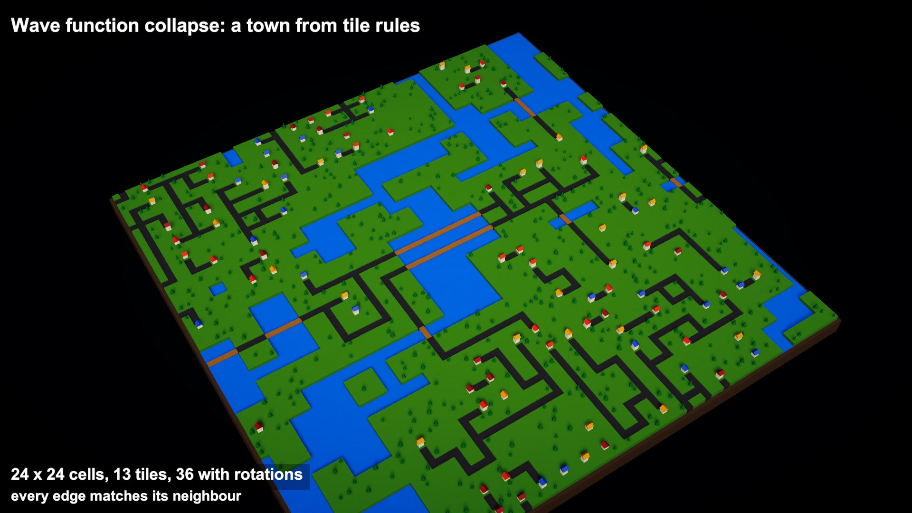

# Wave Function Collapse Town

This town was built by one rule: a tile may only touch a tile whose edge matches. Wave function collapse decides the most constrained cell first, then passes the new limits to its neighbours.

## The problem

Random tiles look like noise. Roads stop in the middle of a field, rivers end in a wall of grass. Hand-placing hundreds of tiles fixes that but takes hours, and the result never changes.

## How it works

This follows Maxim Gumin's open-source WaveFunctionCollapse, the Simple Tiled Model.

1. Every cell starts with every tile still possible.

2. Pick the cell with the lowest entropy: the fewest options left, weighted by how common each tile is.

3. Choose one of its tiles at random, using the tile weights.

4. Propagate: each neighbour drops the tiles that can't sit next to the new one, and that spreads to their neighbours.

5. Repeat until every cell has exactly one tile.

If a cell ever runs out of options, that's a contradiction and the run restarts with a new seed.

## What I hit

The source reads tiles and a hand-written neighbour list from XML. I made every tile a 3 x 3 pattern of grass, road, water, bridge and house, and two tiles may touch when their touching edges are identical. The neighbour list is computed, not typed.

My first shore tile was two thirds water. Every lake turned into a maze of thin canals. A shore with one third water fixed it.

The source only checks cell 0 for a contradiction. That is enough: an empty cell takes away the support of every neighbour option, so the emptiness spreads across the whole grid.

## My build

Unity 6.3 URP. The solver is a C# port of Model.cs: same wave, counters, entropy, Observe, Ban and Propagate.

24 x 24 cells, 13 tiles, 36 with rotations.

0 contradictions in 100 seeds. About 2.5 ms per town on an Apple M4 Mac mini (C#, CPU).

The shown town took 533 picks for 576 cells: propagation alone decided the other 43.

Random tiles with the same weights: 785 of 1,104 edges don't match. WFC: 0.

The town in the video is the first seed with 15 to 30 % water, 3 or more bridge cells and 60 or more houses.

## Trade-offs

The rules are local. Every edge matches, but roads don't form one network: most of them are short streets ending at a house.

Bigger or stricter tile sets hit contradictions more often, and this version restarts instead of backtracking.

Big-scale shape (one river, a town centre) needs extra constraints or a second pass.

## When to use it

Level layouts, towns, dungeons and texture tiles where local fit matters more than the big picture, and anywhere you want a new map from the same tile set every time.

## Credits

Technique source: mxgmn/WaveFunctionCollapse, https://github.com/mxgmn/WaveFunctionCollapse, commit de7d22e705e816b62b4d613199d0463820fcaef3. License: MIT, Copyright (c) 2016 Maxim Gumin.

Code reused: yes, ported to C# inside Unity. From Model.cs: the wave and compatible counters, the entropy heuristic with a tiny random noise, Observe (weighted pick, Helper.Random), Ban, Propagate and Clear, non-periodic. From SimpleTiledModel.cs: the tile rotation formula, rotated copies keeping the tile weight, and the propagator layout (allowed neighbours per direction).

My own code: the 13 procedural tiles (3 x 3 patterns of grass, road, water, bridge and house) and their weights, neighbour rules computed from matching edges instead of the source's XML list, the 3D town meshes (blocks, houses, trees, bridge decks), the random-tiles comparison, the options-left bar view, playback of the recorded run, labels.

Engine: Unity 6.3 LTS, Universal Render Pipeline.

No tile images, XML files or samples from the repo. No external models, textures or images.

## Files

- `Editor/BuildScene.cs`
- `WFCDirector.cs`
- `WFCModel.cs`
- `WFCTiles.cs`
- `WFCTown.cs`

## Build the scene

In the Unity editor: **Vidar Game Lab > Techniques**, then **Build** next to `wave-function-collapse`. From the command line: `tools/capture.sh wave-function-collapse GameTech.Posts.WFCScene.Build`.
